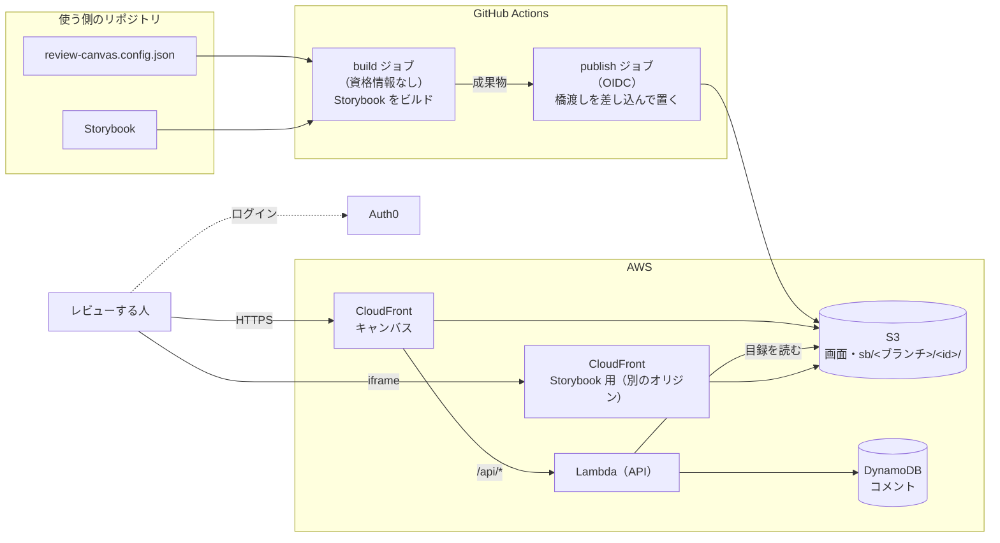

# review-canvas

Storybook の画面を Figma のような大きなキャンバスに並べ、画面にピンを刺してコメントするレビュー用のアプリです。

- 画面（ストーリー）を「画面名（Storybook のタイトル）ごとに 1 段、状態を横に並べる」形で一覧でき、拡大・縮小・移動しながら見比べられます
- 気になった場所をクリックしてコメント（ピン）を置き、返信・解決で話を閉じられます。ピンはクリックした要素を覚え、レイアウトが変わっても追いかけます
- コメントは Git のブランチごとに分かれます。1 つの URL にブランチごとの Storybook を置き、画面の「ブランチ」で切り替えてレビューします
- 書き出した Markdown を Issue・PR に貼れば指摘をそのまま作業に移せ、「AI 向け」の書き出しはコーディングエージェントに渡せば直す場所を特定できる形です

並べる Storybook は設定ファイル（`review-canvas.config.json`）で決めます。アプリのコードには依存せず、読むのは各 Storybook のビルド結果だけです。

## しくみ



- キャンバス（ログインのトークンを持つ側）と Storybook（ブランチごとに誰でも置き換えられるコード）は別のオリジンで配り、`postMessage` の橋渡しだけでつなぎます（[docs/security.md](docs/security.md)）
- 手元では、同じ API サーバーがキャンバス（4100）と Storybook（4102）を別のポートで配り、コメントは DynamoDB Local に書きます

## はじめる（サンプルの Storybook で試す）

前提: Node.js 22.12 以上（24 を推奨）・pnpm 10（`corepack enable`）・Docker。

```bash
git clone https://github.com/ShuntaToda/review-canvas.git
cd review-canvas
pnpm install
pnpm run docker:up          # DynamoDB Local（ポート 8000）
pnpm run build:storybook    # サンプルのショップの Storybook（examples/sample-storybook）をビルドする
pnpm dev                    # → http://localhost:4100
```

最初に名前を入れると（手元は擬似ログイン）、サンプルの「商品一覧」「注文フォーム」の画面が並びます。「コメント（C）」で画面をクリックするとピンを置けます。

自分のリポジトリの Storybook を並べるときは、[docs/host-setup.md](docs/host-setup.md) のとおりに設定ファイルを置き、`node bin/review-canvas.mjs dev --config ../my-app/review-canvas.config.json` で起こします。

## できること

- ページ: 設定ファイルの Storybook ごとに、画面名ごとに 1 段、状態（ストーリー）を横に並べる（「横に N 枚」で折り返す。部品は「部品も表示」で出す）
- 見る: ドラッグ・ホイール・矢印キーで移動、Ctrl/⌘ + ホイール・ピンチで拡大縮小、縮図（ミニマップ）・画面名の絞り込み・画面の幅の切り替え
- 読み込み: 見えている画面だけを順番に読み込み、play 関数を持つストーリーは 1 つずつ動かす。離れた画面は外し、画面の高さは中身に合わせる
- 操作: 「操作（I）」で画面の中を実際に触れる。ほかのモードでは画面の中にフォーカスを残さない
- コメント: 「コメント（C）」でピンを置き、返信・解決/再開・本文の編集と削除（書いた本人だけ）。AI が直したスレッドは「確認待ち」になり、確かめて解決にするか、未解決へ差し戻す。ピンはクリックした要素を覚え、幅や並びが変わっても追いかける
- 一覧・共有: 右の一覧で未解決・確認待ち・解決済みを絞り込み、押すとそのピンへ移る。URL がいまの表示に合わせて変わり、そのまま共有できる。コメントは 10 秒ごとに読み直す
- ブランチ: `?branch=` でブランチの Storybook とコメントに切り替える（Storybook を置いていないブランチはコメントだけ読める）
- AI と回す: MCP サーバー（`bin/review-canvas-mcp.mjs`）で、AI が未解決のコメントを読み、直したら返信して「確認待ち」にする（[docs/ai.md](docs/ai.md)）
- 書き出し: Markdown・JSON をコピー・保存。「Issue 向け」はチェックリスト、「AI 向け」は要素の手がかりのすべて（ストーリーのファイル・HTML の抜き出し・コンポーネント名など）、「JSON」は道具・AI に機械で読ませる形

ショートカットは画面右上の「?」で一覧できます（V 移動・C コメント・I 操作・+/- 拡大縮小・Shift+1 全体・Shift+0 100%・矢印キー 移動・/ 絞り込み・] 一覧の開閉・Esc 閉じる）。

- 入力欄で Esc を押すと、書きかけがあれば入力欄から抜けるだけで、もう一度 Esc で閉じます。書きかけ（新しいピン・スレッドごとの返信）は閉じても残り、開き直すと戻ります（ページを読み直すと消えます）
- 日本語の変換中の Esc・Ctrl/⌘ + Enter は変換に使い、閉じたり送ったりしません
- Tab の最初で「コメント一覧へ移る」が出ます（キャンバスを飛ばして一覧へ）
- 返信・絞り込みなどの入力欄にフォーカスがあるあいだは、play 関数を持つ（かもしれない）画面を新しく読み込みません（play 関数にフォーカスを取られないように。入力欄から離れると続きを読み込みます）
- 読み込み途中の画面を外すと、その画面の API の読み込み（msw）が打ち切られ、コンソールに「Failed to fetch」が出ることがあります。外した画面のもので、害はありません

## ドキュメント

| 文書                                                             | 内容                                                                                                |
| ---------------------------------------------------------------- | --------------------------------------------------------------------------------------------------- |
| [docs/host-setup.md](docs/host-setup.md)                         | 使う側のリポジトリでの準備（設定ファイルの項目・CLI・呼ぶワークフローの例・CDK に組み込む）         |
| [docs/deploy.md](docs/deploy.md)                                 | AWS へ出す・片付ける（設定・出力・はじめて使うときの手順）                                          |
| [docs/auth0.md](docs/auth0.md)                                   | Auth0 の設定（メールのワンタイムコード・招待制・使う人を足す・Post Login の Action・AI が呼ぶ M2M） |
| [docs/github-aws-permissions.md](docs/github-aws-permissions.md) | GitHub と AWS に要る権限（発行用ロール・Environment・変数）                                         |
| [docs/publishing.md](docs/publishing.md)                         | ブランチの Storybook を置く・消す（置き場・手元から・GitHub Actions から）                          |
| [docs/security.md](docs/security.md)                             | セキュリティの考え方（別のオリジン・橋渡し・ログイン・置くときの守り）                              |
| [docs/ai.md](docs/ai.md)                                         | AI に直してもらう（MCP サーバーの道具・環境変数・Claude Code への登録・スキル）                     |
| [llms.txt](llms.txt)                                             | AI 向けの入口（文書の一覧）                                                                         |
| [docs/design-screenshots.md](docs/design-screenshots.md)         | 設計メモ: コメントにスクリーンショットを残す（まだ作っていない）                                    |
| [docs/api.md](docs/api.md)                                       | API・データ・要素の手がかり・AI 向けの書き出し                                                      |
| [docs/development.md](docs/development.md)                       | 開発・テスト・リリースと互換性                                                                      |
| [docs/architecture.md](docs/architecture.md)                     | つくりと決まり（層ごとの置き場・やってはいけないこと・API や画面の機能を足すときの順番）            |
| [docs/adr/README.md](docs/adr/README.md)                         | 決定の記録（SPA と Lambda・小さな AWS の構成・別のオリジン・状態の導出・契約の生成・道具で縛る）    |

npm には出していません。使う側は、このリポジトリのコミットを指して使います（[docs/development.md](docs/development.md#リリースと互換性)）。
