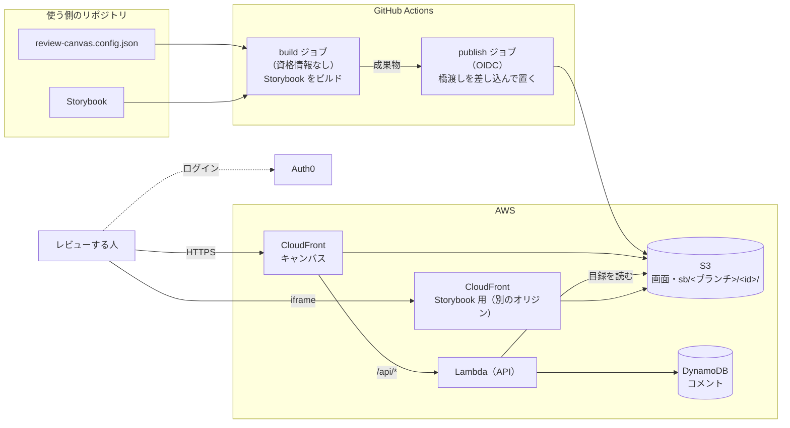

# review-canvas

Storybook の画面を Figma のような大きなキャンバスに並べ、画面にピンを刺してコメントするレビュー用のアプリです。

- 画面（ストーリー）を「画面名（Storybook のタイトル）ごとに 1 段、状態を横に並べる」形で一覧でき、拡大・縮小・移動しながら見比べられます
- 気になった場所をクリックしてコメント（ピン）を置き、返信・解決で話を閉じられます。ピンはクリックした要素を覚え、レイアウトが変わっても追いかけます
- コメントは Git のブランチごとに分かれます。1 つの URL にブランチごとの Storybook を置き、画面の「ブランチ」で切り替えてレビューします
- 書き出した Markdown を Issue・PR に貼れば指摘をそのまま作業に移せ、「AI 向け」の書き出しはコーディングエージェントに渡せば直す場所を特定できる形です

並べる Storybook は設定ファイル（`review-canvas.config.json`）で決めます。アプリのコードには依存せず、読むのは各 Storybook のビルド結果だけです。

## しくみ



- キャンバス（ログインのトークンを持つ側）と Storybook（ブランチごとに誰でも置き換えられるコード）は別のオリジンで配り、`postMessage` の橋渡しだけでつなぎます（[docs/security.md](docs/security.md)）
- 手元では、同じ API サーバーがキャンバス（4100）と Storybook（4102）を別のポートで配り、コメントは DynamoDB Local に書きます

## はじめる（サンプルの Storybook で試す）

前提: Node.js 22.12 以上（24 を推奨）・pnpm 10（`corepack enable`）・Docker。

```bash
git clone https://github.com/ShuntaToda/review-canvas.git
cd review-canvas
pnpm install
pnpm run docker:up          # DynamoDB Local（ポート 8000）
pnpm run build:storybook    # サンプルのショップの Storybook（examples/sample-storybook）をビルドする
pnpm dev                    # → http://localhost:4100
```

最初に名前を入れると（手元は擬似ログイン）、サンプルの「商品一覧」「注文フォーム」の画面が並びます。「コメント（C）」で画面をクリックするとピンを置けます。

自分のリポジトリの Storybook を並べるときは、[docs/host-setup.md](docs/host-setup.md) のとおりに設定ファイルを置き、`node bin/review-canvas.mjs dev --config ../my-app/review-canvas.config.json` で起こします。

## できること

| 区分     | 内容                                                                                                                                                                                                                                                                                                                                                                                                                                                                                                                                                                                                                                                   |
| -------- | ------------------------------------------------------------------------------------------------------------------------------------------------------------------------------------------------------------------------------------------------------------------------------------------------------------------------------------------------------------------------------------------------------------------------------------------------------------------------------------------------------------------------------------------------------------------------------------------------------------------------------------------------------ |
| ページ   | 設定ファイルの Storybook（ページ）を切り替える。画面名ごとに 1 段、状態（ストーリー）を横に並べ、「横に N 枚」（4〜16。既定 8）で折り返す。部品（Components/・Hooks/）は「部品も表示」で出す。絞り込みで 0 件なら知らせる                                                                                                                                                                                                                                                                                                                                                                                                                              |
| 見る     | ドラッグ・ホイール・矢印キーで移動、Ctrl/⌘ + ホイール・ピンチ・ボタンで拡大縮小、全体を表示、縮図（ミニマップ）で移動。画面名で絞り込み。画面の幅を切り替え（設定ファイルの `widths`）                                                                                                                                                                                                                                                                                                                                                                                                                                                                 |
| 読み込み | 見えている画面だけを順番待ちで読み込む。play 関数を持つストーリーは 1 つずつ動かし、描画と play 関数が終わってから次へ進む（同じページの中ではフォーカスが 1 つしかなく、play 関数どうしがフォーカスを取り合って Storybook と違う状態になるため。play 関数の無いストーリーは待たずに次を読み込む）。15 秒で終わらなければ打ち切って次へ進む。見えている範囲から画面の半分ほど離れたら外し、見えていない画面は最近見ていた順に 8 枚までしか残さない（`model/live-frames.ts` の `MAX_LIVE_FRAMES`。外すときは中のフォーカスを外して about:blank へ移してから外す）。小さく表示しているあいだは読み込まず、読み込み済みも外す。画面の高さは中身に合わせる |
| 操作     | 「操作（I）」で画面の中を実際に触れる（入力・タブの切り替えなど）。ほかのモードでは画面の中にフォーカスを残さない（ストーリーの autofocus に取られたら元いた所へ戻す。play 関数の途中は待ち、終わってから戻す。15 秒で打ち切る）。ただし返信・絞り込みなどの入力欄で書いている途中に取られたら、play 関数の途中でもすぐ取り返す（その画面は Storybook と違う状態になりうるので、見出しに「再読み込み」を出す）。画面の中で入力欄にいなければ V・C・I・? も効く。フォーカスしている見た目を見せるストーリーはキャンバスでは再現できないので、Storybook で見る                                                                                           |
| コメント | 「コメント（C）」で画面をクリックしてピンを置く。位置は画面の左上からの px で持つので、並べ方・倍率を変えてもずれない。返信（1 段）・解決/再開（誰でも）・本文の編集と削除（書いた本人だけ。ログインした利用者 ID で確かめる）。本文は 2,000 文字まで。書いた人はログインした利用者。いまと違う幅で書いたピンには印を付け、書いた幅へ切り替えられる。置いたときにクリックした要素の手がかり（下の「要素の手がかり」）も残し、読み込んだ画面でその要素を見つけたらピンを要素に合わせて置き直し（幅や並びが変わっても追いかける）、ピンを指す・開くと要素を枠で示す。見つからなければ置いたときの位置に出し、「?」の印を付ける                           |
| 一覧     | 右の一覧で未解決・解決済み・すべて、画面ごとに絞り込む。押すとそのピンへ移動して開く（移る先の画面は見えている範囲の外でも先に読み込み、高さ・ピンの位置が決まるたびにカメラが追う。利用者が動かしたら追うのをやめる）                                                                                                                                                                                                                                                                                                                                                                                                                                 |
| ブランチ | ブランチを切り替えると、そのブランチの Storybook とコメントに入れ替わる（URL の `?branch=`。無ければ既定のブランチ）。Storybook を置いていないコメントだけのブランチは「（ビルドなし）」と出し、コメントだけ読める。置いてある Storybook と違うコミットで書かれたコメントには印を付ける                                                                                                                                                                                                                                                                                                                                                                |
| 共有     | URL（`?page=&story=&comment=`）がいまの表示（真ん中に見えている画面・開いているスレッド）に合わせて変わり、そのまま共有できる。`?comment=` で開いたときも、一覧から押したときと同じくピンを追う。コメントは 10 秒ごとに差分を読み直す。削除されたスレッドは「このコメントは削除されました」と知らせる                                                                                                                                                                                                                                                                                                                                                  |
| 書き出し | Markdown をコピー・`.md` で保存。「Issue 向け」は GitHub のチェックリスト（キャンバス・Storybook へのリンクと、要素の要約付き）、「AI 向け」はストーリーのファイル・URL と要素の手がかりのすべて（HTML の抜き出し・コンポーネント名・見た目など）を書き、AI に渡せばどこを直すか特定できる形。名前・画面名の改行と記号は打ち消し、本文の HTML のタグは文字のまま出す                                                                                                                                                                                                                                                                                   |

ショートカットは画面右上の「?」で一覧できます（V 移動・C コメント・I 操作・+/- 拡大縮小・Shift+1 全体・Shift+0 100%・矢印キー 移動・/ 絞り込み・] 一覧の開閉・Esc 閉じる）。

- 入力欄で Esc を押すと、書きかけがあれば入力欄から抜けるだけで、もう一度 Esc で閉じます。書きかけ（新しいピン・スレッドごとの返信）は閉じても残り、開き直すと戻ります（ページを読み直すと消えます）
- 日本語の変換中の Esc・Ctrl/⌘ + Enter は変換に使い、閉じたり送ったりしません
- Tab の最初で「コメント一覧へ移る」が出ます（キャンバスを飛ばして一覧へ）
- 返信・絞り込みなどの入力欄にフォーカスがあるあいだは、play 関数を持つ（かもしれない）画面を新しく読み込みません（play 関数にフォーカスを取られないように。入力欄から離れると続きを読み込みます）
- 読み込み途中の画面を外すと、その画面の API の読み込み（msw）が打ち切られ、コンソールに「Failed to fetch」が出ることがあります。外した画面のもので、害はありません

## ドキュメント

| 文書                                                             | 内容                                                                                        |
| ---------------------------------------------------------------- | ------------------------------------------------------------------------------------------- |
| [docs/host-setup.md](docs/host-setup.md)                         | 使う側のリポジトリでの準備（設定ファイルの項目・CLI・呼ぶワークフローの例・CDK に組み込む） |
| [docs/deploy.md](docs/deploy.md)                                 | AWS へ出す・片付ける（設定・出力・はじめて使うときの手順）                                  |
| [docs/auth0.md](docs/auth0.md)                                   | Auth0 の設定（メールのワンタイムコード・招待制・使う人を足す・Post Login の Action）        |
| [docs/github-aws-permissions.md](docs/github-aws-permissions.md) | GitHub と AWS に要る権限（発行用ロール・Environment・変数）                                 |
| [docs/publishing.md](docs/publishing.md)                         | ブランチの Storybook を置く・消す（置き場・手元から・GitHub Actions から）                  |
| [docs/security.md](docs/security.md)                             | セキュリティの考え方（別のオリジン・橋渡し・ログイン・置くときの守り）                      |
| [docs/api.md](docs/api.md)                                       | API・データ・要素の手がかり・AI 向けの書き出し                                              |
| [docs/development.md](docs/development.md)                       | 開発・テスト・リリースと互換性                                                              |

npm には出していません。使う側は、このリポジトリのコミットを指して使います（[docs/development.md](docs/development.md#リリースと互換性)）。
