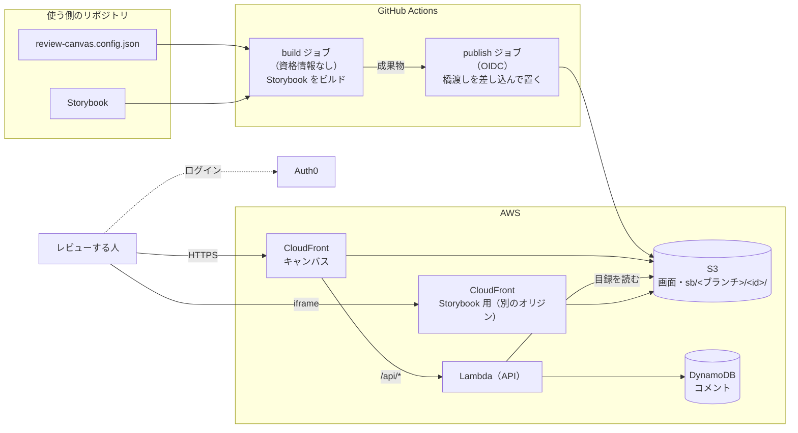

# review-canvas

Storybook の画面を Figma のような大きなキャンバスに並べ、画面にピンを刺してコメントするレビュー用のアプリです。

- 画面（ストーリー）を「画面名（Storybook のタイトル）ごとに 1 段、状態を横に並べる」形で一覧でき、拡大・縮小・移動しながら見比べられます
- 気になった場所をクリックしてコメント（ピン）を置き、返信・解決で話を閉じられます。ピンはクリックした要素を覚え、レイアウトが変わっても追いかけます
- コメントは Git のブランチごとに分かれます。1 つの URL にブランチごとの Storybook を置き、画面の「ブランチ」で切り替えてレビューします
- 書き出した Markdown を Issue・PR に貼れば指摘をそのまま作業に移せ、「AI 向け」の書き出しはコーディングエージェントに渡せば直す場所を特定できる形です

並べる Storybook は設定ファイル（`review-canvas.config.json`）で決めます。アプリのコードには依存せず、読むのは各 Storybook のビルド結果だけです。

## しくみ



- キャンバス（ログインのトークンを持つ側）と Storybook（ブランチごとに誰でも置き換えられるコード）は別のオリジンで配り、`postMessage` の橋渡しだけでつなぎます（[docs/security.md](docs/security.md)）
- 手元では、同じ API サーバーがキャンバス（4100）と Storybook（4102）を別のポートで配り、コメントは DynamoDB Local に書きます

## はじめる（サンプルの Storybook で試す）

前提: Node.js 22.12 以上（24 を推奨）・pnpm 10（`corepack enable`）・Docker。

```bash
git clone https://github.com/ShuntaToda/review-canvas.git
cd review-canvas
pnpm install
pnpm run docker:up          # DynamoDB Local（ポート 8000）
pnpm run build:storybook    # サンプルのショップ（examples/sample-storybook）と、review-canvas 自身の画面の Storybook をビルドする
pnpm dev                    # → http://localhost:4100
```

最初に名前を入れると（手元は擬似ログイン）、サンプルの「商品一覧」「注文フォーム」の画面が並びます。「コメント（C）」で画面をクリックするとピンを置けます。上の「ページ」を「review canvas」に替えると、review-canvas 自身の作業の画面を状態ごとに描いた Storybook が並びます（動かし方・ストーリーを足すときの決まりは [docs/development.md](docs/development.md#review-canvas-自身の-storybook)）。

自分のリポジトリの Storybook を並べるときは、[docs/host-setup.md](docs/host-setup.md) のとおりに設定ファイルを置き、`node bin/review-canvas.mjs dev --config ../my-app/review-canvas.config.json` で起こします。

前のコミットから上げるときは、設定ファイルの `baseHeight` が必須になっています（[docs/development.md](docs/development.md#移し方-画面の幅高さの既定をなくした版へ)）。

## できること

- ページ: 設定ファイルの Storybook ごとに、画面名ごとに 1 段、状態（ストーリー）を横に並べる（「横に N 枚」で折り返す。部品は「部品も表示」で出す。どちらも左の一覧の下の「表示」にある）
- 画面の一覧: 左の一覧に、キャンバスと同じ並びで画面と状態を出し、押すとその状態へ移る。画面はタイトルの「/」の段ごとのフォルダに入り、フォルダは折りたためる（開閉はこのブラウザにページごとに覚える）。フォルダの「ここだけ表示」で、キャンバス・画面の一覧・コメント一覧をそのフォルダの画面に絞る（URL の `scope`。見せ方だけで、守りではない）。上に画面名の絞り込みと「変わった画面だけ」、下に表示の設定（幅・横に N 枚・部品も表示）。`[` で開閉する
- 一覧の幅: 左右の一覧の幅は、キャンバスとの境目のドラッグか、境目にフォーカスして ← →（16px ずつ）で、200px から窓の幅の 40% まで変えられ、このブラウザに覚える（境目のダブルクリックで元の幅に戻る。狭い画面では一覧を全体に重ねて出すので変えない）
- 見る: ドラッグ・ホイール・矢印キーで移動、Ctrl/⌘ + ホイール・ピンチで拡大縮小、縮図（ミニマップ）・画面名の絞り込み・画面の幅の切り替え（設定の幅のほかに、好きな幅を自分用に足せる。このブラウザに覚える）
- 読み込み: 置くときに撮った画像を並べ、触る画面（クリックした・コメントか操作の道具を重ねた・十分に寄った・見え方を合わせている画面と、見えていて、要素に合わせるピンの位置をまだ確かめていない画面）だけを本物の Storybook（iframe）に切り替える。画像の画面をクリックしてコメントを置くときは、動く画面に切り替わるのを待ってから置き、画像と中身がずれていたら（高さが違う）置かずにクリックし直してもらう。画像の無いブランチ・幅は、見えている画面だけを iframe で読み込む（同時に 3 つまで。play 関数を持つストーリーは 1 つずつ）。離れた画面は外し、画面の高さは中身に合わせる
- 操作: 「操作（I）」で画面の中を実際に触れる。ほかのモードでは画面の中にフォーカスを残さない
- 画面のつながり: ストーリーに書いた遷移（[docs/host-setup.md](docs/host-setup.md#画面のつながり遷移を書く)）を、遷移を持つ要素（薄い青の枠）から行き先の画面への矢印で出す。上の帯の「画面のつながり」で、選んだ画面（真ん中に見えている画面。スレッドを開いていればその画面）の線だけ・すべて（ほかの線は薄い点線）・出さない を選ぶ（このブラウザに覚える）。矢印の札を押すと行き先へ寄り（隠れていれば絞り込み・見せる範囲を外す）、キャンバスの上の「← <元の画面名>へ戻る」で何段でも戻れる。「この画面からつながる画面だけ表示」で、選んだ画面からたどれる画面だけに絞る（URL には載せない）。画像を撮っていない幅・ブランチでは出さない
- コメント: 「コメント（C）」でピンを置き、返信・解決/再開・本文の編集と削除（書いた本人だけ）。AI が直したスレッドは「確認待ち」になり、確かめて「解決にする」か、直っていなければ「差し戻す」（未解決に戻る）。吹き出しの「‹ ›」か J / K で、一覧の並びのまま前後のスレッドへ移る。ピンはクリックした要素を覚え、幅や並びが変わっても追いかける（見つからないときだけ「?」の印）。画面の名前の横に、その画面の未解決・確認待ちの件数を出す
- 一覧・共有: 右の一覧で未解決・確認待ち・解決済みを絞り込み、押すとそのピンへ移る。URL がいまの表示（ブランチ・ページ・見せる範囲・画面・スレッド・一覧の状態のタブ・比べる画面・比べる相手）に合わせて変わり、そのまま共有できる。画面の見出しの「この画面のリンクをコピー」で、その画面を指すリンクをコピーできる（いまの幅と見せる範囲も載せ、同じ幅で開く。開いた人が選べない幅なら既定の幅で開く。開くと画面の周りを枠で示す）。コメントは 10 秒ごとに読み直す
- ブランチ: `?branch=` でブランチの Storybook とコメントに切り替える（Storybook を置いていないブランチはコメントだけ読める）。切り替えても、真ん中に見えていた画面をそのまま開き、見せる範囲も保つ（合う画面が無ければ外す）
- ほかのブランチと見比べる: Storybook を置いてあるブランチが 2 つ以上あり、今のブランチも置いてあれば（コメントだけのブランチでは比べない）、画面の見出しのボタンでその画面をほかのブランチ（比べる相手）と比べる（「並べる」と、違う所が明るく出る「重ねる」。画像の名前（中身のハッシュ）で見分け、画素は読まない。コメントは置けない）。比べる相手は上の帯の「比較するブランチ」で、置いてあるブランチから今のブランチを除いたものと「比較しない」から選ぶ（ブランチ名で検索でき、↑↓・Enter・Esc で操作できる。初めは、既定のブランチ以外を見ているときは既定のブランチ、既定のブランチを見ているとき・既定のブランチを置いていないときは「比較しない」。相手を替えると「変わった画面だけ」は外れる。「比較しない」のときは比べるボタン・印・「変わった画面だけ」を出さない）。`?compare=`・`?base=`（「比較しない」は `?base=-`）で共有できる。左の一覧に、比べる相手と比べた「変更」「新しい」の印を出し、「変わった画面だけ」で絞り込む（どちらかのブランチに画像の目録が無いときは出さない。日時・乱数を出す画面や、撮った環境（フォントなど）が違う画面は「変更」に出ることがある。比べる相手で撮るのが時間切れになった画面は、相手の目録に無いので「新しい」に出る）
- AI と回す: MCP サーバー（`bin/review-canvas-mcp.mjs`）で、AI が未解決のコメントを読み、直したら返信して「確認待ち」にする（[docs/ai.md](docs/ai.md)）
- 書き出し: Markdown・JSON をコピー・保存。「Issue 向け」はチェックリスト、「AI 向け」は要素の手がかりのすべて（ストーリーのファイル・HTML の抜き出し・コンポーネント名など）、「JSON」は道具・AI に機械で読ませる形

ショートカットは画面右上の「?」で一覧できます（V 移動・C コメント・I 操作・+/- 拡大縮小・Shift+1 全体・Shift+0 100%・矢印キー 移動・/ 絞り込み・J / K 次・前のコメント・[ 画面の一覧の開閉・] コメント一覧の開閉・Esc 閉じる）。

- 入力欄で Esc を押すと、書きかけがあれば入力欄から抜けるだけで、もう一度 Esc で閉じます。書きかけ（新しいピン・スレッドごとの返信）は閉じても残り、開き直すと戻ります（ページを読み直すと消えます）
- 日本語の変換中の Esc・Ctrl/⌘ + Enter は変換に使い、閉じたり送ったりしません
- Tab の最初で「コメント一覧へ移る」が出ます（キャンバスを飛ばして一覧へ）
- 返信・絞り込みなどの入力欄にフォーカスがあるあいだは、play 関数を持つ（かもしれない）画面を新しく読み込みません（play 関数にフォーカスを取られないように。入力欄から離れると続きを読み込みます）
- 読み込み途中の画面を外すと、その画面の API の読み込み（msw）が打ち切られ、コンソールに「Failed to fetch」が出ることがあります。外した画面のもので、害はありません

## ドキュメント

| 文書                                                             | 内容                                                                                                                   |
| ---------------------------------------------------------------- | ---------------------------------------------------------------------------------------------------------------------- |
| [docs/host-setup.md](docs/host-setup.md)                         | 使う側のリポジトリでの準備（設定ファイルの項目・ストーリーに遷移を書く・CLI・呼ぶワークフローの例・CDK に組み込む）    |
| [docs/deploy.md](docs/deploy.md)                                 | AWS へ出す・片付ける（設定・出力・はじめて使うときの手順）                                                             |
| [docs/auth0.md](docs/auth0.md)                                   | Auth0 の設定（メールのワンタイムコード・招待制・使う人を足す・Post Login の Action・AI が呼ぶ M2M）                    |
| [docs/github-aws-permissions.md](docs/github-aws-permissions.md) | GitHub と AWS に要る権限（発行用ロール・Environment・変数）                                                            |
| [docs/publishing.md](docs/publishing.md)                         | ブランチの Storybook を置く・消す（置き場・手元から・GitHub Actions から）                                             |
| [docs/security.md](docs/security.md)                             | セキュリティの考え方（別のオリジン・橋渡し・ログイン・置くときの守り）                                                 |
| [docs/ai.md](docs/ai.md)                                         | AI に直してもらう（MCP サーバーの道具・環境変数・Claude Code への登録・スキル）                                        |
| [llms.txt](llms.txt)                                             | AI 向けの入口（文書の一覧）                                                                                            |
| [docs/design-screenshots.md](docs/design-screenshots.md)         | 設計メモ: コメントにスクリーンショットを残す（コメントに結び付ける部分は未実装）                                       |
| [docs/api.md](docs/api.md)                                       | API・データ・要素の手がかり・AI 向けの書き出し                                                                         |
| [docs/development.md](docs/development.md)                       | 開発・テスト・Issue から PR までの流れ（AI と回す。スキルとレビュー役の一覧は [llms.txt](llms.txt)）・リリースと互換性 |
| [docs/architecture.md](docs/architecture.md)                     | つくりと決まり（層ごとの置き場・やってはいけないこと・API や画面の機能を足すときの順番）                               |
| [docs/adr/README.md](docs/adr/README.md)                         | 決定の記録（SPA と Lambda・小さな AWS の構成・別のオリジン・状態の導出・契約の生成・道具で縛る）                       |

npm には出していません。使う側は、このリポジトリのコミットを指して使います（[docs/development.md](docs/development.md#リリースと互換性)）。
