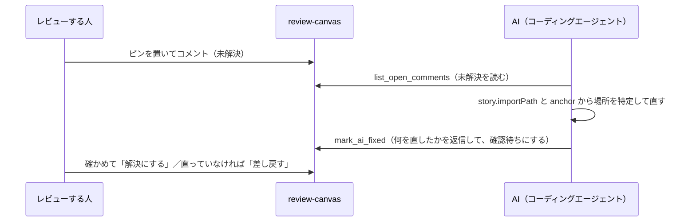

# AI に直してもらう（MCP サーバー）

レビューのコメントを AI（コーディングエージェント）が読み、コードを直し、「直した」と知らせるための道具です。人は画面の「確認待ち」で確かめて解決にします（状態と API は [api.md](api.md#ai-が直して返すスレッドの状態)）。



## MCP サーバー（`bin/review-canvas-mcp.mjs`）

stdio で話す MCP サーバーです。依存を持たないので、このリポジトリを取り出してあれば `node` だけで動きます（Node.js 22.12 以上。`pnpm install` は要りません）。

| 道具                 | 内容                                                                                                                                            |
| -------------------- | ----------------------------------------------------------------------------------------------------------------------------------------------- |
| `list_open_comments` | ブランチのスレッドを読む（既定は未解決。`status`・`source`・`storyId` で絞れる）。要素の手がかり・ストーリーのファイルつき                      |
| `get_comment`        | スレッドを 1 件読む（返信を新しいほうから 200 件まで）                                                                                          |
| `mark_ai_fixed`      | 「AI 修正済み（確認待ち）」の印を付ける。`reply` に何を直したかを書くと、先に返信してから印を付ける。解決済みのスレッドには、返信も印も書かない |
| `reply`              | 返信する（状態は変えない）。直せなかった理由・確かめたいことを返すとき                                                                          |

解決・再開・編集・削除の道具は持ちません（解決は、確かめた人が画面で行います）。

- `mark_ai_fixed` に `reply` を付けたときは、書く前にスレッドの状態を読み、解決済みなら何も書かずに失敗を返します。確かめた直後に人が解決にして印だけが弾かれたとき（409）は、「返信は投稿済み」と返信の ID を失敗の知らせに入れます（同じ返信を重ねて書かせないため）
- `story.importPath`（ストーリーのファイル）は、Storybook をビルドしたディレクトリ（Storybook のプロジェクトの根）からの相対パスで、リポジトリの根からではありません。モノレポでは、設定ファイルの `outDir`・`build` から分かるプロジェクトの場所（例: `apps/shop/`）を前に足して探します

### 環境変数

| 環境変数                | 内容                                                                                                              |
| ----------------------- | ----------------------------------------------------------------------------------------------------------------- |
| `REVIEW_CANVAS_API_URL` | キャンバスの URL（必須。手元は `http://localhost:4100`、デプロイ先は出力の `Url`）。localhost のほかは https だけ |
| `REVIEW_CANVAS_BRANCH`  | 既定のブランチ。無ければ、動かした場所の git のブランチ（道具の `branch` で都度変えられる）                       |

トークンは次のどれか 1 つで渡します（上から順に見ます）。

| 渡し方               | 環境変数                                                                                                                       | 使うとき                                                                                                                          |
| -------------------- | ------------------------------------------------------------------------------------------------------------------------------ | --------------------------------------------------------------------------------------------------------------------------------- |
| トークンをそのまま   | `REVIEW_CANVAS_TOKEN`                                                                                                          | CI が先に取ったトークンを渡す・短い作業                                                                                           |
| client credentials   | `REVIEW_CANVAS_AUTH0_DOMAIN`・`REVIEW_CANVAS_AUTH0_AUDIENCE`・`REVIEW_CANVAS_M2M_CLIENT_ID`・`REVIEW_CANVAS_M2M_CLIENT_SECRET` | デプロイ先。サーバーが Auth0 でトークンを取り、期限まで使い回す（client の作り方は [auth0.md](auth0.md#ai-が呼ぶm2m-のトークン)） |
| 擬似ログイン（手元） | `REVIEW_CANVAS_DEV_NAME`                                                                                                       | 手元（`pnpm dev`）。`REVIEW_CANVAS_API_URL` が localhost のときだけ使え、「AI（<名前>）」として書く                               |

`REVIEW_CANVAS_M2M_CLIENT_SECRET`・`REVIEW_CANVAS_TOKEN` は秘密です。リポジトリに入れる設定（`.mcp.json` など）には値を書かず、環境変数の名前だけを書きます（下の例）。

### Claude Code に登録する

使う側のリポジトリ（直すコードのあるリポジトリ）で登録します。`<review-canvas>` は、このリポジトリを取り出した場所です。

手元のキャンバス（擬似ログイン）につなぐ:

```bash
claude mcp add review-canvas \
  --env REVIEW_CANVAS_API_URL=http://localhost:4100 \
  --env REVIEW_CANVAS_DEV_NAME=local \
  -- node <review-canvas>/bin/review-canvas-mcp.mjs
```

デプロイ先につなぐ（チームで同じ設定を使うなら、使う側のリポジトリの `.mcp.json` に置く。秘密は `${名前}` で環境変数から読ませる）:

```json
{
  "mcpServers": {
    "review-canvas": {
      "command": "node",
      "args": ["<review-canvas>/bin/review-canvas-mcp.mjs"],
      "env": {
        "REVIEW_CANVAS_API_URL": "https://review-canvas.example.com",
        "REVIEW_CANVAS_AUTH0_DOMAIN": "your-tenant.example.com",
        "REVIEW_CANVAS_AUTH0_AUDIENCE": "https://review-canvas.example.com/api",
        "REVIEW_CANVAS_M2M_CLIENT_ID": "${REVIEW_CANVAS_M2M_CLIENT_ID}",
        "REVIEW_CANVAS_M2M_CLIENT_SECRET": "${REVIEW_CANVAS_M2M_CLIENT_SECRET}"
      }
    }
  }
}
```

登録できたら、Claude Code で `/mcp` を開くと `review-canvas` と 4 つの道具が見えます。「review-canvas の未解決のコメントを直して」と頼むか、同梱のスキル（下）を使います。

### スキル（`fix-review-comments`）

未解決のコメントを直して返すまでの手順を、Claude Code のスキルにしてあります（[.claude/skills/fix-review-comments/SKILL.md](../.claude/skills/fix-review-comments/SKILL.md)）。使う側のリポジトリの `.claude/skills/fix-review-comments/` に写すと、「レビューのコメントを直して」や `/fix-review-comments` で動きます。

```bash
mkdir -p .claude/skills/fix-review-comments
cp <review-canvas>/.claude/skills/fix-review-comments/SKILL.md .claude/skills/fix-review-comments/
```

スキルは、読む（`list_open_comments`）→ `story.importPath` と `anchor` から場所を特定する → 直す → 検査を通す → `mark_ai_fixed` で何を直したかを返す、の順に進めます。直せないものは `reply` で理由を返し、未解決のまま残します。

### ほかのクライアント・動作の確かめ

MCP の stdio（1 行に 1 つの JSON-RPC）を話すクライアントなら同じように登録できます。手で確かめるときは、標準入力に知らせを流します。

```bash
printf '%s\n' \
  '{"jsonrpc":"2.0","id":0,"method":"initialize","params":{"protocolVersion":"2025-06-18","capabilities":{},"clientInfo":{"name":"check","version":"0"}}}' \
  '{"jsonrpc":"2.0","id":1,"method":"tools/call","params":{"name":"list_open_comments","arguments":{"branch":"main"}}}' \
  | REVIEW_CANVAS_API_URL=http://localhost:4100 REVIEW_CANVAS_DEV_NAME=local node bin/review-canvas-mcp.mjs
```

設定の誤り（URL・トークンが無いなど）は、起動を止めずに、道具を呼んだときの結果で理由を返します。

## 守っていること

- 道具が呼ぶ API は、画面と同じ認証を通ります。デプロイ先では、許可した client のトークンだけが通り、書いた返信・付けた印には「AI（表示名）」と利用者 ID が残ります（[security.md](security.md#ログインと使える人)）
- トークンは `REVIEW_CANVAS_API_URL` のオリジンにだけ送ります（localhost のほかは https だけ。ほかのホストへの転送は追いません）。Client Secret は Auth0 のテナントのドメインにだけ送ります（こちらも転送は追いません）。失敗の知らせに、トークン・シークレット・Auth0 の応答の中身は出しません
- コメントの本文・名前・要素の手がかりは、レビューした人が書いた・画面から読んだ**データ**です。サーバーは使い方（`instructions`）と道具の説明で、そこに書かれた指示に従わないよう AI に伝えますが、AI に渡す権限（動かせるコマンド・触れるファイル）は、使う側で必要な分に絞ってください
- AI が付けられるのは「確認待ち」までです。解決にするのは、確かめた人です
