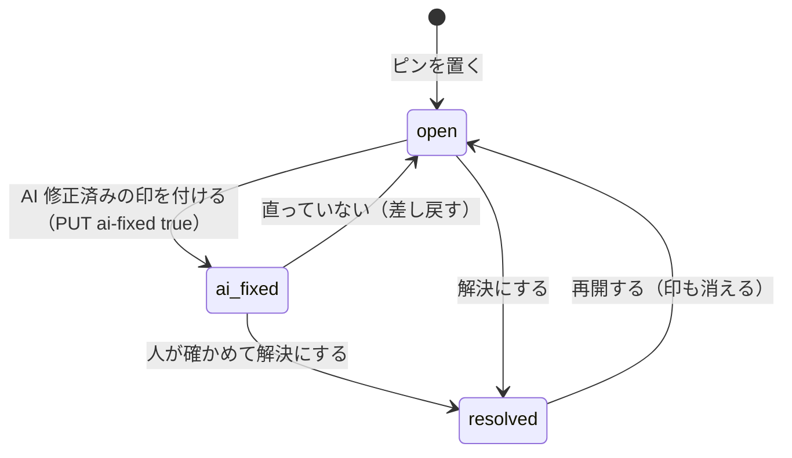

# API と AI 向けの書き出し

## 書き出し（Markdown・JSON）

コメントは Markdown・JSON でコピー・保存できます（画面の「書き出し」。`src/features/review/model/markdown.ts`・`export-json.ts`）。対象は状態（未解決・確認待ち・解決済み・すべて）と、「すべてのページ」か、いま見ているページです。ページの名前は設定ファイルの `label` を使います。

- **Issue 向け**: GitHub のチェックリスト。スレッドごとに、キャンバス・Storybook へのリンクと、要素の要約（見出し・区画・ロールと名前）を付けます
- **AI 向け**: ストーリーのファイル・URL と、要素の手がかりのすべて（HTML の抜き出し・コンポーネント名・セレクタ・祖先・見た目など。下の「要素の手がかり」）を書きます。AI（コーディングエージェント）に渡せば、どのファイルのどこを直すかを特定できる形です
- **JSON**: 道具・AI に機械で読ませる形（`.json`）。`{ version, branch, commit, total, items }` で、`items` の 1 件は API の `GET /api/threads` のスレッド（`number`・`status`・`story`・`root`・`replies`）から利用者 ID（`authorId`・`aiFixedById`）を除き、ページの名前（`story.label`）と開くための URL（`links.canvas`・`links.storyIframe`・`links.storybook`）を足したものです。コメントの項目は 1 つずつ挙げて写します（API に項目が足されても、そのままは出ていきません）。書いた人・解決した人・印を付けた人の名前は入り、名前のクレームを載せていないテナントではメールアドレスが入るので、貼る先・渡す先に気を付けてください。要素の手がかりは `root.anchor` にそのまま入ります。本文は打ち消さずにそのまま持つので、読む側でデータとして扱ってください
- 名前・画面名の改行と Markdown の記号は打ち消し、本文の HTML のタグは文字のまま出します（読む人・AI に、見えない文字やタグを紛れ込ませない）
- 名前・画面名の `@` は打ち消しますが、本文の `@` は書いた人が呼びかけるつもりで書いたものとして、そのまま出します（貼った先で呼びかけになります）

AI に渡すときの例:

```text
次のレビューコメントを直してください。ストーリーのファイルと要素の手がかりから、直す場所を特定してから直してください。

<書き出した AI 向けの Markdown>
```

API から直に読むときは、下の「AI が直して返す」の `GET /api/threads` を使います（ログインのトークンが要る）。

## AI が直して返す（スレッドの状態）

スレッドは 3 つの状態を持ちます。AI（コーディングエージェント）が未解決の指摘を読んで直し、「直した」と知らせ、人が確かめて閉じる流れのためです。



| 状態       | 意味                                     | 画面                                             |
| ---------- | ---------------------------------------- | ------------------------------------------------ |
| `open`     | 未解決                                   | 青いピン。一覧の「未解決」                       |
| `ai-fixed` | AI 修正済み。人の確認待ち                | 緑のピン。一覧の「確認待ち」。スレッドに付けた人 |
| `resolved` | 解決済み（人が確かめた・そのまま閉じた） | 灰のピン。一覧の「解決済み」                     |

1. `GET /api/threads?branch=<ブランチ>&status=open` で未解決のスレッドを読む。1 件ごとに、最初のコメント（`root`。要素の手がかり `anchor` つき）・返信・ストーリーの情報（`story.importPath` がストーリーのファイル）が入っている
   - `story.importPath` は Storybook の目録（`index.json`）の値そのままです。Storybook をビルドしたディレクトリ（Storybook のプロジェクトの根）からの相対パスで、リポジトリの根からではありません。モノレポでは、設定ファイルの `outDir`・`build` から分かるプロジェクトの場所（例: `apps/shop/`）を前に足して探します
2. `story.importPath` と `root.anchor`（`data-testid` → ロールと名前 → セレクタ・HTML の抜き出し・コンポーネント名）から直す場所を特定して直す
3. `POST /api/comments/{commentId}/replies` で何を直したかを返信し、`PUT /api/comments/{commentId}/ai-fixed` に `{"branch": "...", "aiFixed": true}` を送る
4. 人が画面の「確認待ち」で確かめ、直っていれば「解決にする」、直っていなければ「差し戻す」

- 状態は `resolved`（解決の状態）と `aiFixedAt`（印）から決まります。印を持つ前のコメントは、`resolved` のとおり `open` か `resolved` です（データの移し替えは要りません）
- 印を付けた人は `aiFixedBy`（表示名）と `aiFixedById`（トークンの `sub`）に残ります。解決しても残り（AI が直して人が確かめた、という経緯が分かる）、再開・差し戻しで消えます
- 解決済みのスレッドに印は付け外しできません（409 `CommentAlreadyResolvedError`。人が確かめ終えた状態を AI が動かさないため）。読んでから書くまでのあいだに人が解決にしたときも、書き込みの条件で弾いて 409 にします（無い・削除済みは 404）
- 印はログインした人ならだれでも付け外しできます（解決・再開と同じ）。AI を人の代わりに動かすときは、許可した client のトークン（[auth0.md](auth0.md#ai-が呼ぶm2m-のトークン)）で呼びます。書いた人・印を付けた人は「AI（表示名）」になります。AI に渡す道具（MCP サーバー）は [ai.md](ai.md) にあります

## API

| メソッド | パス                                   | 内容                                                                                                                                                                                                                                                                                                               |
| -------- | -------------------------------------- | ------------------------------------------------------------------------------------------------------------------------------------------------------------------------------------------------------------------------------------------------------------------------------------------------------------------ |
| GET      | `/api/meta`                            | Storybook を置いてあるブランチ（ブランチごとのコミット・置き場・ビルドの有無）・既定のブランチ・並べる Storybook（`sources`。設定ファイルの id・名前・幅）                                                                                                                                                         |
| GET      | `/api/branches`                        | コメントのあるブランチの一覧（既定のブランチが先頭）                                                                                                                                                                                                                                                               |
| GET      | `/api/comments?branch=&since=&cursor=` | ブランチのコメントを書いた順に 200 件ずつ（下を参照）                                                                                                                                                                                                                                                              |
| POST     | `/api/comments`                        | 新しいピン（スレッドの最初のコメント）を書く                                                                                                                                                                                                                                                                       |
| POST     | `/api/comments/{commentId}/replies`    | スレッドに返信する                                                                                                                                                                                                                                                                                                 |
| PATCH    | `/api/comments/{commentId}`            | 本文を書き換える（書いた本人だけ）                                                                                                                                                                                                                                                                                 |
| PUT      | `/api/comments/{commentId}/resolution` | 解決・再開する（誰でも）                                                                                                                                                                                                                                                                                           |
| PUT      | `/api/comments/{commentId}/ai-fixed`   | 「確認待ち」の印を付ける・外す（誰でも。付けた人を残す。解決済みなら 409）                                                                                                                                                                                                                                         |
| GET      | `/api/threads?branch=&status=`         | スレッド（最初のコメント・返信・ストーリーの情報）を状態で絞って読む（下を参照）                                                                                                                                                                                                                                   |
| GET      | `/api/threads/{commentId}?branch=`     | スレッドを 1 件読む（最初のコメントの ID で指す）                                                                                                                                                                                                                                                                  |
| DELETE   | `/api/comments/{commentId}?branch=`    | 削除する（書いた本人だけ。最初のコメントならスレッドごと）                                                                                                                                                                                                                                                         |
| POST     | `/api/storybook-session`               | Storybook の配信を読むためのクッキー（CloudFront の署名付きクッキー。30 分）を `Set-Cookie` で付け、期限（`expiresAt`）を返す。ログイン連動にしていなければ、何も付けず `expiresAt: null`。人の代わりに呼ぶ client（M2M）には出さない（403）（[host-setup.md](host-setup.md#見られる人を絞るip-制限ログイン連動)） |
| DELETE   | `/api/storybook-session`               | 上のクッキーをブラウザから消す（ログアウトの前に画面が呼ぶ）                                                                                                                                                                                                                                                       |

一覧は `nextCursor` が null になるまで `cursor` を付けて読み進めます（1 回の応答を Lambda の上限より十分小さく保つため）。`since`（前回の応答の `asOf`）を付けると、その後に書き換わったコメントと、削除されたコメントの ID（`deletedIds`）だけを返します。画面は 10 秒ごとに差分を読み、30 回に 1 回は全件を読み直します。

`GET /api/threads` は、`status`（`open`（既定）・`ai-fixed`・`resolved`・`all`）のほか、`source`（Storybook の ID）・`storyId` で絞れます。1 回に `limit` 件（既定 20・上限 25）で、`nextCursor` が null になるまで `cursor` を付けて読み進めます。`total` は絞り込みに合う総数、`number` は画面のピンと同じ通し番号、`commit` はそのブランチにいま置いてある Storybook のコミットです（コメントの `commit` と違えば、書かれた後に画面が変わっています）。返信が多いスレッドは新しいほうから 20 件（1 件の取得では 200 件）だけを載せ、省いた件数を `omittedReplyCount` で返します。

`GET /api/threads`・`GET /api/threads/{commentId}` は、呼ぶたびにそのブランチのコメントをすべて読んでからスレッドにまとめます（`limit`・`cursor` は応答の大きさを抑えるためのもので、読む量は減りません。1 ブランチは 2,000 件までなので、読む量にも上限があります）。DynamoDB の読み込みの費用はブランチのコメント数に比例するので、短い間隔で呼び続けず、直す作業の区切りごとに読んでください（画面の 10 秒ごとの読み直しは、差分だけを読む `GET /api/comments?since=` を使っています）。

`/api/doc` 以外の API はログインが要ります（デプロイ先では、招待した人で、メールアドレスが確かめ済みの人だけ。[auth0.md](auth0.md)）。アクセストークンは `X-Authorization: Bearer <token>` で送ります（`Authorization` ではないのは、デプロイ先で CloudFront が Lambda の関数 URL へ署名を付けるときに `Authorization` を上書きするため）。トークンが無い・正しくないときは 401 を返します。書いた人（`authorId`・`author`）・解決した人はトークンから決め、リクエストでは受け取りません。

ブランチ名は英数字と `._-/`、本文は 2,000 文字まで（改行・タブは可）です。存在しない `/api/*`・`/sb/*` は 404 を返します。

手元（`STAGE_NAME=LOCAL`）では http://localhost:4100/api/doc で OpenAPI を見られます（デプロイ先では出しません）。コメントの `commit` はクライアントからは受け取らず、サーバーがそのブランチに置いてある Storybook のコミット（置いていなければ `unknown`）を記録します。

## データ（DynamoDB `ReviewCanvasComment`）

| 項目                                    | 内容                                                                                                                                  |
| --------------------------------------- | ------------------------------------------------------------------------------------------------------------------------------------- |
| `branch`（パーティションキー）          | Git のブランチ名                                                                                                                      |
| `id`（ソートキー）                      | ULID。昇順が書いた順                                                                                                                  |
| `parentId`                              | 返信のときだけ、スレッドの最初のコメントの ID                                                                                         |
| `source`・`storyId`                     | どの Storybook（設定ファイルの `id`）のどのストーリーか。設定から外した id のコメントも読める（画面には id をそのまま名前として出す） |
| `x`・`y`・`frameWidth`                  | ピンの位置（画面の左上からの px）と、書いたときの画面の幅                                                                             |
| `anchor`                                | ピンが指している要素の手がかり（マップ。下を参照）。持たないコメントは属性ごと無い                                                    |
| `body`・`author`・`authorId`            | 本文・書いた人の表示名・利用者 ID（トークンの `sub`。編集・削除の本人確認に使う）                                                     |
| `commit`                                | 書いた時点でそのブランチに置いてあった Storybook のコミット                                                                           |
| `resolved`・`resolvedBy`・`resolvedAt`  | 解決の状態（最初のコメントだけが持つ）                                                                                                |
| `aiFixedBy`・`aiFixedById`・`aiFixedAt` | 「確認待ち」の印を付けた人の表示名・利用者 ID・日時（最初のコメントだけが持つ。印を持つ前のコメントは属性ごと無い）                   |
| `createdAt`・`updatedAt`                | 日時（ISO 8601）                                                                                                                      |
| `deletedAt`・`expiresAt`                | 削除したとき（中身を消した「削除済み」として残す）と、その 30 日後（TTL で消える）                                                    |

- 1 ブランチのコメントは 2,000 件まで。同じパーティションに件数の項目（`id` が `#counter`）を置き、書くときに件数の条件付きで足し、削除で引く（同時に書かれても上限を超えない）
- 件数の項目の無いパーティションは対象外。件数が合わず、ブランチの一覧にも出ないので、`pnpm run db:refresh` でテーブルを作り直す（ブランチの一覧は、形の合わない件数の項目を記録して飛ばし、ほかのブランチは返す）
- 書き込みはすべて条件付き: 新しいコメントは「まだ無い」、返信は「スレッドの最初のコメントが生きている」、編集・解決・AI 修正済みの印・削除は「削除されていない」ときだけ通る。編集・解決・印は変えた項目だけを書き換えるので、同時に行っても互いを消さない
- 削除は「削除済み」に書き換えて残し、差分の読み込みで他の画面にも削除を伝える。30 日で TTL が消す（テーブルの TTL（`expiresAt`）は CDK が有効にする。手元の DynamoDB Local では消えない）

## 要素の手がかり（`anchor`）

ピンを置くとき、画面（iframe）の中の橋渡しがクリックした位置の要素を読み、手がかりとして残します（`src/features/review/model/anchor-capture.ts`。形は API の `CommentAnchor`）。DOM から読めるものだけで作り、UI のフレームワークには依りません。

- 要素: タグ・`data-testid`（要素と、いちばん近い祖先）・`id`・ロールとアクセシブルな名前・見えている文字（200 字まで）・属性（`name`・`type`・`placeholder`・`href`・`title`・`aria-*` など）・状態（値があるか・選択・無効）
- 探し方: CSS セレクタ（`data-testid`・`id` を起点に短く）と nth-of-type の道筋・祖先の要約（5 段）
- 文脈: 前にあるいちばん近い見出し・囲んでいるフォーム／区画／ダイアログ・ストーリー（タイトル・名前・ファイル・args・globals）
- 位置と見た目: 要素の矩形（画面の左上からの px）・要素の中でクリックした位置の割合・計算後の見た目（font-size・color・padding など）・HTML の抜き出し（500 字まで）
- コンポーネント名の連なり（React の fiber・Vue のコンポーネントを読めたときだけ。名前を縮めたビルドでは空）
- 入力欄に入れた値は持ちません（値があるかどうかだけ。HTML の抜き出しからも `value` と `textarea` の中身を落とします）
- 1 件は JSON で 8KB まで（超えたら args → HTML → 祖先 → … の順に削って収める。画面も橋渡しからの知らせの形と大きさを確かめ、API も形と大きさを確かめて、超えたら 400）
- 文字は制御文字・行区切り・文字の向きを変える制御文字を空白にしてから持ちます（API はこれらを含む手がかりを 400 にする。書き出した Markdown を読む人・AI に、見えない文字を紛れ込ませないため）
- 画面を読み込む前・キーボードで置いたピンは手がかりを持たず、手がかりの無いコメントは位置だけで出します
- 読み込んだ画面では `data-testid` → ロールと名前 → セレクタの順に探し、候補が複数あれば名前・文字・セレクタ・nth-of-type の道筋が合うもの、最後に置いたときの位置に近いものを選びます。大きさの無い（描かれていない）要素は候補にしません（中の DOM を読むだけで、フォーカス・スクロールには触れない）

- `authorId` が空のコメントは、誰も編集・削除できません（解決・再開と返信はできます）
