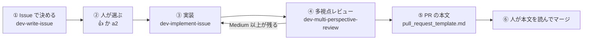

# 開発・テスト・リリース

## 手元で動かす

前提: Node.js 22.12 以上（24 を推奨）・pnpm 10（`corepack enable`）・Docker（DynamoDB Local）。

```bash
pnpm install
pnpm run docker:up          # DynamoDB Local（ポート 8000）
pnpm run build:storybook    # サンプルの Storybook（examples/sample-storybook/storybook-static）と、review-canvas 自身の画面の Storybook（storybook-static）をビルドする
pnpm dev                    # → http://localhost:4100（Storybook は http://localhost:4102 で配る）
```

`pnpm dev` は、vite が http://localhost:4100 で画面を配り（保存するとすぐ反映）、API はポート 4101 で起こした API サーバーへ vite が転送します。Storybook は同じ API サーバーが別のオリジン http://localhost:4102 で配り（転送しない）、橋渡しは `dev:bridge` が保存のたびにビルドし直します（反映は Storybook の画面を読み直したとき）。
画面をビルドして 1 つのサーバーで配るときは `pnpm run serve`（2 回目からは `pnpm run local`）です。

- 手元の設定は `.env` です。無ければ起動のときに `.env.example` から作ります（`pnpm run config:local`）。DynamoDB Local へつなぐ値（`AWS_ENDPOINT_URL_DYNAMODB`・`AWS_REGION`・`AWS_ACCESS_KEY_ID`・`AWS_SECRET_ACCESS_KEY`）は、シェルに AWS の資格情報があっても `.env` の値を使います（`AWS_SESSION_TOKEN`・`AWS_PROFILE` は外す）
- 並べる Storybook は設定ファイル（`REVIEW_CANVAS_CONFIG`。既定はこのリポジトリの `review-canvas.config.json`）から読みます。別のリポジトリの Storybook を並べるときは `review-canvas dev --config ../my-app/review-canvas.config.json`（ブランチ・コミットはそのリポジトリの git から読む）
- Storybook は、デプロイ先と同じく画面と別のオリジン（`http://localhost:4102`）で配ります。ストーリーのコードを画面（ログインのトークンを持つ側）と同じオリジンで動かさないためです。画面と Storybook は、配るときに `iframe.html` へ差し込む橋渡し（`review-canvas-bridge.js`。`pnpm run build:bridge` で `dist-bridge/` にできる。`local`・`serve` はビルドしてから起こす）と `postMessage` だけでやり取りします（[security.md](security.md#storybook-との橋渡しsrcfeaturesreviewbridge)）
- 橋渡しが受け付ける画面のオリジンは `CANVAS_ORIGINS`（カンマ区切り。既定は `http://localhost:4100,http://127.0.0.1:4100`）です。`PORT` で画面を別のポートで配るときは合わせてください
- 2 回目からは `pnpm run local`（画面のビルドを省く）で起動できます
- コメントのテーブル（`ReviewCanvasComment`）が無ければ、起動時に作ります。中身を空にしたいときは `pnpm run db:refresh`
- Storybook のビルドが無いページは、画面にビルドの手順を出します（ほかのページは使えます）。Storybook を直したら `pnpm run build:storybook` をやり直し、ブラウザを開き直してください
- 手元では擬似ログインです。最初に名前を入れると、その名前（利用者 ID は `dev|<名前>`）でコメントを書けます。署名の無いトークンなので、API は `STAGE_NAME=LOCAL` かつ `AUTH_MODE=dev`（`.env`）のときだけ受け付けます。右上のアカウントのボタンを押して「ログアウト」で名前を入れ直せます（別のタブで名前を変えると、開いているタブも合わせて切り替わります）。API が 401 を返したとき（ログインの期限切れ）は、画面に「ログインし直す」を出します
- サーバーは自分の端末（`127.0.0.1`）だけで待ち受けます（擬似ログインは誰でも名乗れるため）
- 手元で Auth0 のトークンを確かめたいときは、`.env` の `AUTH_MODE` を `auth0` にし、`AUTH0_ISSUER`・`AUTH0_AUDIENCE` を入れてください（画面の擬似ログインのトークンは通らなくなります）
- 手元では、起動したときの Git の状態（`git rev-parse`）のブランチ・コミットに、手元のビルド結果を 1 件置いてあるものとして扱います（`/sb/<id>/`）。別のブランチとして書きたいときは `.env` の `REVIEW_BRANCH`・`REVIEW_COMMIT` で上書きできます。ほかのブランチはコメントだけ読めます（ブランチの一覧に「（コメントのみ）」と出る）

## つくり

層ごとの責務・置き場・足すときの順番は [architecture.md](architecture.md)、決めたことの記録は [adr/](adr/README.md) にあります。

```
review-canvas/
├── api/                      # API（Hono・zod-openapi。domain / use-case / infrastructure / presenter / di-container / handler の層分け）
│   ├── domain/               # Comment（ドメインモデル）・リポジトリの契約・PublishedStorybooks（置いてあるブランチ）
│   ├── use-case/             # 一覧・作成・返信・編集・解決/再開・削除・ブランチ一覧・メタ情報
│   ├── infrastructure/       # DynamoDB のリポジトリ・置いてあるブランチ（手元は Git とビルド結果、デプロイ先は S3 の目録）・設定ファイル（config/）
│   ├── presenter/ util/      # エラーレスポンス・日時・テスト用の道具
│   ├── di-container/         # inversify の登録
│   └── handler/api/          # ルート・entrypoint/{local,lambda,cli}
├── src/                      # 画面（React）
│   ├── features/review/      # model（座標・配置・スレッド・Markdown など純粋な処理）・components・hooks・pages・bridge（Storybook との橋渡し）
│   ├── support/ utils/
│   └── generated/            # openapi.json から作る API の型（生成物・コミットしない）
├── infra/                    # CDK（コンストラクト ReviewCanvas・そのまま出すアプリ・出す用のロールのアプリ）と、ブランチの Storybook を置くスクリプト（scripts/）
├── examples/sample-storybook # 架空のショップのサンプル Storybook（React + Vite・play 関数・msw）
├── bin/                      # CLI（review-canvas.mjs）・MCP サーバー（review-canvas-mcp.mjs）
├── eslint-rules/             # このリポジトリだけの ESLint ルール（層ごとのファイルの形など）
├── scripts/                  # 開発用のスクリプト（new-api.mjs: API の雛形）・リポジトリの決まりのテスト
├── .claude/                  # Claude Code の hook・スキル（dev-*: このリポジトリの開発用）・レビュー用のサブエージェント（agents/）
├── .github/workflows/        # ci.yml（このリポジトリの CI）・auto-merge-claude.yml（.claude/ だけの PR の自動マージ）・publish.yml（使う側から呼ぶ再利用ワークフロー）・deploy.yml（既定のブランチからスタックを出す。変数で有効にしたときだけ）・storybook.yml（push でブランチの Storybook を置く。変数で有効にしたときだけ）
├── .github/ISSUE_TEMPLATE/   # 親 Issue・PR 単位の Issue・不具合のテンプレート（pull_request_template.md は PR の本文）
├── review-canvas.config.json # サンプルの設定（並べる Storybook）。review-canvas.config.schema.json は生成物
└── openapi.json              # API の契約（生成物）
```

## 検証

```bash
pnpm run validate          # eslint・prettier・tsc（API・画面・設定）・cspell・knip・設定の JSON Schema が最新か
pnpm run test              # API・画面・道具の small・medium テスト（medium は DynamoDB Local を使う。先に docker:up）
pnpm run test:small        # small だけ（Docker なし）
pnpm run test:structure    # つくりの決まりのテストと、自前の lint ルール・雛形・hook のテストだけ（数秒）
pnpm run test:coverage     # すべてのテストと、層ごとのカバレッジの下限（CI はこれを動かす）
pnpm run openapi:check     # openapi.json が API のコードと合っているか（手元のファイルと比べる。コミットの前でも確かめられる）
pnpm run infra:validate    # infra の tsc・prettier・eslint
pnpm run infra:test        # infra のテスト（スタックの形・置くスクリプト・配信の関数。撮影のテストは Chromium を使う）
pnpm --dir examples/sample-storybook run validate
```

- `infra:test` は、遷移のボタンを実際のブラウザで探すテスト（`infra/test/story-transitions-capture.small.test.ts`）に Playwright の Chromium を使います。先に `pnpm --dir infra exec playwright install chromium` で入れておきます（CI の test ジョブも入れる）
- API を変えたら `pnpm run openapi:generate` で `openapi.json` を作り直します（画面の型 `src/generated/` は `codegen` で作る。どちらも手で直さない）
- 設定ファイルの形（`api/infrastructure/config/review-canvas-config.ts`）を変えたら `pnpm run config:schema` で `review-canvas.config.schema.json` を作り直します
- テストの名前は `*.small.test.ts`（外につながない）・`*.medium.test.ts`（DynamoDB Local を使う）です
- CDK の組み立て（Lambda のバンドルを含む）は、架空の値で確かめられます: `REVIEW_CANVAS_AUTH0_DOMAIN=tenant.example.com REVIEW_CANVAS_AUTH0_CLIENT_ID=dummy REVIEW_CANVAS_AUTH0_AUDIENCE=https://review-canvas.example.com/api pnpm run synth --quiet`
- 使う側の CDK アプリに組み込んだ形は、CI の「Synth embedded」が `infra/test/embedded-app.ts` を infra の外から動かして確かめます
- ワークフロー（`.github/workflows/`）は CI の actionlint で確かめます。手元では `actionlint` をそのまま動かします（`shellcheck` が PATH に無いと run のシェルを確かめずに通るので、先に入れておく）
- コミットの前後に lefthook が prettier・eslint（pre-commit）、メッセージが 1 行で AI の署名が無いこと（commit-msg）、tsc・openapi・cspell・つくりのテスト・knip（pre-push）を確かめます
- コミットメッセージの決まりは `scripts/check-commit-message.mjs` にあり、CI のジョブ commit-messages が PR のコミットの範囲にも同じものをかけます（`--no-verify`・GitHub の画面で作ったコミットも見る）。マージコミットは見ません（「Update branch」などで GitHub が作り、文面を選べない）。`git revert` が付ける本文（`This reverts commit …`。件名が `Revert "`・`Reapply "` で始まるもの）だけは 1 行の例外として認めます（戻したコミットを指す決まった形のため）。手元（commit-msg）では、エディタに出る git の案内（`#` だけの行と、`#` の後ろが空白（スペース・タブ）の行。`# On branch …`・`#<TAB>modified: …`・`# Conflicts:`）と、`git commit -v` の切り取り線から後ろを除いてから数えます（コメントの文字を `core.commentChar` で変えていれば、その文字で見る）。`-m "# 本文"` のように案内と同じ形で付けた本文は手元では見分けられないので、CI が見つけます。PR をまとめてマージするときのメッセージは、人が 1 行に直します
- API を 1 本足すときは `pnpm run new:api`（[architecture.md](architecture.md#api-を-1-本足すとき)）。CI の scaffold ジョブが、雛形で作った直後の状態で `validate` と `test:small` を通します

## review-canvas 自身の Storybook

review-canvas の作業の画面を、状態ごとに描いたストーリーです。設定ファイルの 2 つ目の Storybook（`id` は `app`、名前は「review canvas」）として、手元のキャンバスのサンプルのショップの後ろに並びます。

```bash
pnpm run build:storybook:shop   # 先にサンプルのショップを組み立てる（動く画面で開く。下）
pnpm run storybook              # 開発しながら見る（http://localhost:6007）
pnpm run build:storybook:app    # 組み立てる（storybook-static）。build:storybook はサンプルのショップ → app の順に両方を組み立てる
pnpm run check:storybook:app    # 組み立てたものを Chromium で 1 つずつ開いて確かめる（下）
```

写すスクリプト（`scripts/stage-story-storybooks.mjs`）と `check:storybook:app` は、`src/` の TypeScript（`stories/story-branches.ts`・`bridge/inject.ts`）を Node の `--experimental-strip-types` でそのまま読みます。Node 22 はそのたびに試験中の機能の警告を出すので、`--no-warnings=ExperimentalWarning` で黙らせます（ほかの警告は出したまま）。Node がそのまま読むファイルは何も import しません（一覧は `eslint.config.base.mjs` の `SRC_FILES_READ_BY_SCRIPTS`。`src/` 全体に `erasableSyntaxOnly` を効かせ、`enum` など Node が読めない構文も書けない）。

- 設定は `.storybook/`（`main.ts`・`preview.tsx`）、ストーリーは画面・部品のコードの隣（`src/features/*/pages/*.stories.tsx`・`src/features/*/components/*.stories.tsx`。置ける場所はこの 2 つだけで、`.storybook/main.ts` の `stories` と eslint の `STORY_GLOB` が同じ）、ストーリーが使う固定のデータ・MSW の handler・描き方は `src/features/review/stories/` に置きます。画面と同じ vite の設定（React Compiler・`@/` の別名）と Tailwind（`src/index.css`）を使います
- 1 つのストーリーは、画面の入口と同じ `App` を、ストーリー用の偽のログイン（`src/support/auth/fake`。山田 太郎でログイン済み、または未ログイン）で描きます（`stories/ReviewStory.tsx`）。`pnpm dev` の擬似ログイン（`src/support/auth/dev`。名前を入れてログインする）とは別のもので、ストーリーでは使いません。どちらも置く版のビルドには入りません。SWR のキャッシュはストーリーごとに作り直します
- API（`/api/*`）と、置いてあるブランチの Storybook（ストーリーの一覧・画像の目録・画像）は MSW が返します（`stories/story-handlers.ts`）。置いてあるブランチは `main` と `feature/new-cart`（架空）、キャンバスの中身はサンプルのショップを撮った画像と目録（`stories/fixtures/`。幅 375 だけ）です。部品の `Components/Button` も持ち、本物の設定と同じく既定では外します（`excludeTitlePrefixes` の `Components/`）。「見せる範囲を絞った」では「部品も表示」に入れても、範囲（`Shop`）の外なので並ばないことを確かめます。画像を撮り直すときは、サンプルの Storybook を組み立ててから `pnpm --dir infra run screenshots --repo-root <根> --config <shop だけの設定>` で撮り、要る画面を写します（設定の `outDir` は設定ファイルからの相対パスで `..` を書けないので、shop だけ・幅 375 だけの設定は `examples/sample-storybook/` に一時に置き、`outDir` を `storybook-static` にする。撮った後に消す）。撮るのは CI と同じ Linux（ubuntu）の Playwright の Chromium です（`pnpm --dir infra exec playwright install --with-deps --only-shell chromium`）。手元のフォントで撮ると、中身の高さ・要素の位置が CI とずれ、動く画面と比べるストーリー（コメントを書く・スレッドを開くなど）や幅 768 の並びを決め打ちしたストーリーが CI で落ちます
- 固定データの遷移（中のキャンバスの矢印・札）は、`main` の目録（`fixtures/shots-main.json`）だけにあります。撮り直した目録の `transitions` と、遷移のある画像の `shots[].transitions` を、手で直さずにそのまま写します。画像が前と違えば、画像と `path`・`thumb`（と同じ画像の `elements` などの項目）も替えます。`feature/new-cart` の目録は遷移を残す前の形のまま（遷移の無い目録の見え方）で、`Shop/ProductList／Default` を除く画面は `main` と同じ画像を指すので、`main` の画像を替えたら `feature/new-cart` の同じ画面も替えます（見比べで変わる画面は `Shop/ProductList／Default` と `Shop/ProductList／Loading` のまま）。`feature/new-cart` の `Shop/ProductList／Default` の画像は、サンプルの商品一覧のボタンを「カートに追加」にし、木のマグカップに「送料無料」の印を足して撮ったものです（その変更はコミットしない）。`main` の目録には `Shop/ProductList／Loading` を入れません。ストーリーの一覧（`fixtures/shop-index.json`）は、組み立てたサンプルの `index.json` の `entries` から、両ブランチの画面をすべて（各項目の `type`・`id`・`title`・`name`・`importPath` だけ）写し、キャンバスの先頭に商品一覧が来るよう、買い物の流れの順（商品一覧 → 商品詳細 → カート → お届け先 → 確認 → 完了 → ログイン → マイページ → 管理 → 部品）に並べます（並びは組み立てた一覧とは違う）。両ブランチの固定データの形（`feature/new-cart` は `Shop/ProductList／Default` を除いて `main` と同じ画像を指す、など）は `stories/shots-fixtures.small.test.ts` が確かめます。固定データは合わせて 1MB までです（`scripts/repo-rules.small.test.mjs`）。超えたら、自身のストーリーが使わない画面の状態（商品一覧の `failed`、商品詳細の `loading` など）から、両ブランチの一覧と目録から外します。前からの 8 画面（商品一覧の `default`・`empty`・`loading`、注文フォームの 3 状態、管理の注文一覧、部品のボタンの `default`）と、自身のストーリー・ストーリー用のコメント（`stories/story-fixtures.ts`）が指す画面は外しません
- 画面がブラウザに覚える設定（画面のつながりの出し方・自分用に足した幅・選んだ幅・一覧の開閉と幅・横に並べる数など）は、ストーリーごとに空のメモリへ替えてから描きます（`.storybook/preview.tsx` の loaders が `src/support/storage` の `replaceLocalStorageWithMemory` を呼ぶ）。撮影は 1 つのブラウザで同時に数ページを開くので、あるストーリーが変えた設定をほかのストーリーへ持ち越さないためです。置く版の入口からは呼びません（画面のコードから import すると eslint の `no-restricted-imports`、動的 import は `no-restricted-syntax` が止める。置く版のビルドでは関数ごと消えるので、`check:deployed-bundle` の文字では見分けられない）
- 動く画面（スレッドを開いた・コメントを置いたとき、画像の無い幅で開く iframe）は、本物のサンプルのショップです。`build:storybook:app`・`storybook` は、組み立てたサンプルのショップ（設定の shop の outDir）を、橋渡し（`pnpm run build:bridge`）を差し込んでブランチごとに写し（`scripts/stage-story-storybooks.mjs`。写す先は `node_modules/.cache/review-canvas-story`）、`.storybook/main.ts` の `staticDirs` が置き場（`<Storybook の置き場>/review-canvas-story/<ブランチのキー>/shop/`。`stories/story-branches.ts`）として出します。手元の配信・置くスクリプトと同じ印・同じ script の src と属性を、開いたときに書きます（`bridge/inject.ts` の `injectRuntimeBridge`。組み立ては `bridgeTag` と同じ関数）。つないでよいオリジン（`data-canvas-origin`）だけは、開いたときの `location.origin` にします（どこで開くかは組み立てのときに分からないため）。写すのは iframe.html とその読み込みで、Storybook の画面の枠（`index.html`・`sb-manager`・`sb-addons`）、サンプルの撮影の結果（`review-canvas-shots.json`・`review-canvas-shots/`）、サンプルのサービスワーカー（`mockServiceWorker.js`。サンプルの MSW はオリジンの直下のものを登録するので使われない）は写しません。どのブランチの置き場にも同じサンプルを写すので、見比べのストーリーで `feature/new-cart` の画像は変更後の見た目でも、押して動く画面にすると main のサンプルの見た目になります。サンプルのショップの中の通信（`/api/products` など）は、サンプル自身の MSW が返します（サービスワーカーは同じオリジンに 1 つ。msw の版は catalog で同じ）
- ストーリーの handler に無い道への通信（Storybook の外・API の知らない道・置き場の画像の目録と画像）は、`.storybook/preview.tsx` が最後の handler で止めて失敗にし、コンソールに `[MSW]` で出します。iframe の読み込みは MSW を通らないので、`.storybook/main.ts` の CSP（`frame-src` を置き場の `review-canvas-story/` だけにする。オリジンは開いたときに入れる）が止めます
- URL の状態（`?branch=`・`?comment=`・`?scope=` など）は、ストーリーの `parameters.reviewUrl` に書きます。描く前に iframe の URL へ入れ、キャンバスが URL を書き換えても Storybook のクエリ（`?id=`・`?viewMode=`）を残します（`stories/story-url.ts`）
- 押して開く状態（コメントを書いている・ヘルプを開いた・変わった画面だけ）は、play 関数で押して作ります。置くときの撮影は play 関数の終わりを待ちます
- 動く画面を待つ play 関数は `waitForLiveFrame`（`stories/story-play.ts`）で、画面が動く画面に切り替わり、中の橋渡しとつながり（`Frame` の `data-frame-bridge` が `ready`）、中のストーリーが描き終えるのを待ちます。橋渡しがつながらない（「一部の機能が使えません」が出る）ときは落ちます
- play 関数は、終わりに `settle()`（`stories/story-play.ts`）を呼びます。動きが止まるのを待ち、画面を 1 度まるごと描き直して、撮るたびに同じ画素にします（見比べは画像のハッシュで比べるので、角丸のふちが 1 段ずれても「変更」になる）。Storybook の `afterEach` では呼べません（置くときの撮影は、`afterEach` より前の段階 `completed` で撮る）。呼び忘れは `check:storybook:app` が落とします

ストーリーを足すときの決まり:

- タイトルは画面ごとに日本語で `レビュー/<画面>`、ストーリーの `name` は状態を日本語で書きます。ID は英字に保ちます（遷移の行き先にストーリーの ID を使うため）。meta に英字の `id`（`review-workspace` など）を書き、export の名前を英字にします（ID は `<meta の id>--<export の名前の kebab>`）。並べる順は `.storybook/preview.tsx` の `storySort`
- 作業の画面全体を主にします。部品のストーリーは、画面で出しにくい状態があるときだけ、部品の隣（`components/*.stories.tsx`）にタイトル `Components/…` で置きます（設定の `excludeTitlePrefixes` で、既定ではキャンバスに並ばない）
- 名前・文字は架空のもの（山田 太郎・佐藤 花子・サンプルのショップ・`example.com`）にします
- 足したら `scripts/check-app-storybook.mjs` の `APP_STORY_IDS` に ID を足します
- 押すとほかのストーリーの状態になるボタン・文字には、遷移（`parameters.reviewCanvas.transitions`。書き方は [host-setup.md](host-setup.md#画面のつながり遷移を書く)）を書きます。書くのはストーリー（export）の側で、meta には書きません（書くと eslint の `no-restricted-syntax` が止める）。`from` が設定の app の widths（いまは 1280・1440）のどれかで複数に当たるときは、行き先・label は変えずに `heading` で絞ります。撮った後に `check:storybook:app` がどの行も確かめます（下）
- Storybook・MSW・ストーリー用の偽のログイン（`src/support/auth/fake`）と、ストーリーの置き場（`src/features/*/stories/`・`*.stories.tsx`）を import できるのは、ストーリー（`src/features/*/{pages,components}/*.stories.tsx`）・`src/features/*/stories/`・`.storybook/` だけです（eslint の `no-restricted-imports`。動的 import（`import("msw")`）は `no-restricted-syntax`。画面のコードから読むと置く版のビルドに入る）。置く版のビルドに入っていないことは `pnpm run check:deployed-bundle` も確かめます

`check:storybook:app`（CI の build のジョブでも動く）は、決めた状態のストーリーが一覧（`index.json`）にそろって載り ID が英字であること、どのストーリーも描画と play 関数が通ること、play 関数（一覧の tags の `play-fn` で見る）の終わりに `settle()` を呼んでいること（最後の文であることは `scripts/repo-rules.small.test.mjs` が見る）、Storybook の外・MSW に無い道へ通信しないこと（iframe.html と、置き場に写したサンプルのショップの iframe.html の外へのページの移動、CSP が止めた読み込みも含む）、「すべてを選んだ」（`review-transitions--all`）の後に開いたほかのストーリーが既定の出し方（選んだ画面）で始まること（設定を持ち越さない）を確かめます。撮影（`pnpm --dir infra run screenshots`）の後なら、撮った目録（`storybook-static/review-canvas-shots.json`）も読み、ストーリーごとに次を確かめて落とします（行は書いた順で 1 から）。目録が無いとき（撮らずに動かしたとき）は遷移を比べず `目録（review-canvas-shots.json）が無いので、遷移は確かめていません` を出します。CI では `--require-shots` を付けて動かし、目録が無ければ落とします。幅は `--config`（既定は `review-canvas.config.json`）の、id が `app` の Storybook の `widths` から読み、遷移を書いたストーリーにはその幅ごとの画像があることも確かめます。

| 確かめること                                                                             | 落ちたときの文                                                                                                  |
| ---------------------------------------------------------------------------------------- | --------------------------------------------------------------------------------------------------------------- |
| ストーリーに書いた行の数（開いたストーリーの parameters から読む）と、目録の行の数が同じ | `<ストーリー ID>: 書いた遷移は <N> 行ですが、目録には <M> 行しかありません`                                     |
| 目録のどの行も、そのストーリーのどの幅の画像でもボタンの矩形がある                       | `<ストーリー ID>（幅 <幅>）の <行> 行目: 遷移のボタンが見つかりません`                                          |
| どの行の行き先も、組み立てた一覧（`index.json`）にある                                   | `<ストーリー ID> の <行> 行目: 行き先のストーリー <行き先> が一覧にありません`                                  |
| 遷移を書いたストーリーに、設定の app の widths ごとの画像がある                          | `<ストーリー ID>（幅 <幅>）: 目録に画像がありません（遷移のボタンを確かめられません）`                          |
| ストーリーの `parameters.reviewCanvas.transitions` が並び（配列）                        | `<ストーリー ID>: parameters.reviewCanvas.transitions が並び（配列）ではありません`                             |
| 目録を読める（JSON・形）                                                                 | `目録（review-canvas-shots.json）を読めません: <理由>`                                                          |
| `--require-shots` のとき、目録がある                                                     | `目録（review-canvas-shots.json）がありません（撮影の後に動かしてください: …）`                                 |
| 設定を読めて、id が app の Storybook に widths がある                                    | `設定（<ファイル>）を読めません: <理由>`・`設定（<ファイル>）に、id が app の Storybook の widths がありません` |
| 全体の締め切り（6 分）の前に、設定を持ち越さないことを確かめられた                       | `全体の締め切り（6 分）を過ぎたので、設定を持ち越さないことは確かめていません`                                  |

Storybook・MSW・Playwright の版は、サンプルの Storybook・infra と同じものを `pnpm-workspace.yaml` の catalog に書き、`catalog:` で使います。

## Issue から PR まで

このリポジトリ自身の開発は、AI（Claude Code）と次の順に回します。人の手は「Issue で選ぶ」と「PR の本文を読んでマージを決める」の 2 つに絞り、AI は人がすぐ決められる形で書きます。**仕様は人が決め、AI は実装しながら決めません。**



| 段               | 使うもの                                                       | すること                                                                                                                                                                                                   |
| ---------------- | -------------------------------------------------------------- | ---------------------------------------------------------------------------------------------------------------------------------------------------------------------------------------------------------- |
| ① Issue で決める | スキル `dev-write-issue`・`.github/ISSUE_TEMPLATE/`            | 仕様の根拠を読み、決まっていない点を論点ごとの表（選択肢・★推奨・理由）と注釈つきの画面にする。決まったことは本文を書き換えずコメントで残し、親 Issue → PR 単位の Issue の 2 段に書き切る                  |
| ③ 実装           | スキル `dev-implement-issue`（足すものに合わせて `dev-add-*`） | 人が名指しした PR 単位の Issue だけを、実装役のサブエージェントに渡す。Issue に無い仕様に当たったら止めて、Issue で人に確かめる                                                                            |
| ④ 多視点レビュー | スキル `dev-multi-perspective-review`・`.claude/agents/`       | 変更のあった領域のレビュー役だけを、実装役のコミットが済んでから、実装役のブランチで worktree を分けて並列に立てる。書いた本人はレビューしない。直しは書いた実装役に送り、Medium 以上が 0 件になるまで回す |
| ⑤ PR の本文      | `.github/pull_request_template.md`                             | 閉じる Issue・「黙らせた検査・残したこと」・実際に動かしたこと・テストの表・画面の流れ・レビュー実施記録を書く。人がコードを読まずに、本文だけでマージを決められるようにする                               |

- レビュー役は領域ごとに分けてあります（`api-reviewer`・`ui-reviewer`・`infra-reviewer`・`cli-mcp-reviewer`。どれも読むだけ）。コードの変更があるときは、名前・コメント・黙らせ方・文書・公開リポジトリの決まりを、領域をまたぐ `architecture-reviewer` が毎回見ます。文章だけ（Issue・PR 本文の下書き・`docs/`・`README.md`・スキル）のときは、文章のレビュー役の「正しさと出典」が公開リポジトリの決まりも見ます。頼み方（読む順番・確かめ方・返し方）は、スキル `dev-multi-perspective-review` の「3. レビュー役への頼み方」が正本です
- Issue・PR・コメントの下書きは、投稿の前に `node scripts/check-issue-text.mjs <下書き>` を通します（リンクを含む 150 バイト超の塊・@メンション・★が 1 つでない選択肢の行を見つける）。画像は、AI がファイル名だけの印（`【画像を貼る: point-a.png】`）を残し、`node scripts/issue-images.mjs <issue-番号|pr-番号> <下書き> <画像…>` で画像だけを置くブランチ `issue-images` に push して印を `` に置き換え、`--posted` を付けて貼り残しを確かめてから投稿します（push できないときは、人が GitHub の画面で貼る）（手元のパス `/home/`・`/Users/`・`C:\`・`/tmp/` は、投稿の前の検査で見つける）
- 注記つきの画面と画面の流れの 1 枚は `pnpm --dir infra run annotate-screen`（`points`・`flow`。Playwright は infra の依存。パスは絶対パスで渡す）で作ります。ブラウザは、開く画面のオリジン・`allow`（`--allow`）で足したオリジン・手元のファイルの外へ通信せず、リダイレクトで外へ出るのも止めます（キャンバスを撮るときは `--allow http://localhost:4102`）。制約: 要求はすべてスクリプトが取り直して返すので、大きい応答の多い重い画面では撮るのが遅くなります。許したオリジンのあいだを 3xx で移る `fetch` は CORS で落ちます（転送の先の要求は通信の止め方を通らないので、ブラウザに転送を追わせません）。通信の途中で閉じても、許したオリジンのサーバーが止まっていても、その要求が失敗するだけで、ほかの論点は書けます。見本は `.claude/skills/dev-write-issue/examples/`
- 下書き・レビューの記録・画像・レビュー役の worktree は、リポジトリの外の作業フォルダ（既定は `../review-canvas-work/<テーマ>/`）に置き、コミットしません
- push・PR の作成・Issue への投稿は、人が頼んだときだけ。マージと AWS へ出すのは人がします

### main へのマージ

main はルールセットで PR を必須にし、直に push しません。そのうえで、スキル・サブエージェント・hook のように手早く直したい `.claude/` の変更と、レビューを通したいコードの変更とで、マージの仕方を分けます。

- 変更が `.claude/` の中だけの PR は、ワークフロー `auto-merge-claude.yml` が自動マージを付け、CI の必須のチェックが通るとマージされます（マージコミット）。付けるのは、リポジトリの持ち主が、このリポジトリのブランチから出した、下書きでない PR だけです（fork の PR・下書きには付けない）
- 1 つでも `.claude/` の外のファイル（名前を変えたファイルは元の名前も見る）に触れていれば付けません。後から外に触れるコミットを積んだときや、下書きに戻したときは、ワークフローが付けた自動マージを外します。このジョブも必須のチェックに入れているので、外し終えるまでマージされません
- それ以外の PR は、これまでどおり人が本文を読んでマージします
- ワークフローがマージしたコミットでは、main への push の CI は動きません（`GITHUB_TOKEN` の操作は次のワークフローを起こさない）。PR の CI が同じ中身で通っています

リポジトリの設定（人が GitHub の画面でする）:

- Settings → General → Pull Requests で「Allow auto-merge」を入れる
- Settings → Rules → Rulesets で、既定のブランチに「Require a pull request before merging」（承認の数は 0。持ち主は自分の PR を承認できないため）と「Require status checks to pass」（`commit-messages`・`lint`・`actionlint`・`build`・`test`・`scaffold`・`auto-merge-claude`）・「Block force pushes」を付ける

## 道具で縛っている仕組みと理由

決まりは、文章より道具で縛ります（[adr/0007](adr/0007-enforce-by-tools.md)）。決まりの一覧と違反のメッセージは [AGENTS.md](../AGENTS.md#道具で縛っている決まり)、層ごとの置き場は [architecture.md](architecture.md) にあります。ここには、入れている仕組みごとの「防ぐもの」と「引き受けているもの」を残します。

| 仕組み                                                                                                                                                   | 防ぐもの                                                                                                                                                                                                                                                                                                       | 引き受けているもの（遅さ・誤検出・保守）                                                                                                                                                                                                                              |
| -------------------------------------------------------------------------------------------------------------------------------------------------------- | -------------------------------------------------------------------------------------------------------------------------------------------------------------------------------------------------------------------------------------------------------------------------------------------------------------- | --------------------------------------------------------------------------------------------------------------------------------------------------------------------------------------------------------------------------------------------------------------------- |
| 自前の ESLint ルール（`eslint-rules/`。ユースケース・ハンドラの形、ルートとミドルウェアの足し方、エラーの形、時刻と乱数、外部 import、パッケージの境界） | 層ごとの決まりからの外れ。既存のプラグインでは書けない・メッセージに直し方を書けないもの                                                                                                                                                                                                                       | ルールとテストを自分で保つ（8 本・RuleTester のテスト付き）。エラーと日時の整形は型情報でも見る（型を使う lint はもともと有効なので、時間はほぼ変わらない。テストは `eslint-rules/fixtures/` の tsconfig で型を作る）                                                 |
| `import/no-cycle`                                                                                                                                        | 層の向きの決まりをすり抜ける相互依存・読み込み順の不具合                                                                                                                                                                                                                                                       | eslint が数秒伸びる（import 先を読む）                                                                                                                                                                                                                                |
| `check-file`（ファイル名・ディレクトリ名・テストの名前）                                                                                                 | 名前のゆれ。つくりのテスト・雛形が名前から対応を探すので、ゆれると検査が効かなくなる                                                                                                                                                                                                                           | 入口（`src/main.tsx`）とモードの設定（`src/config.test.ts`）の 2 つを対象から外している                                                                                                                                                                               |
| `eslint-comments`・`reportUnusedDisableDirectives`                                                                                                       | 理由の無い disable・直したあとに残った disable・構造を守るルール（`local/*`・層の向き・循環・`no-restricted-*`・`check-file/*`）の disable・コメントでの設定の変更（`/* eslint ルール: "off" */`・`/* global */`・範囲やファイルの `/* eslint-disable */`。使えるのは 1 行だけの disable）                     | メッセージは英語（プラグインのもの。hook が直し方を添える）。構造のルールの例外は、コメントではなく `eslint.config.mjs` の対象・`ignores` に理由つきで書く                                                                                                            |
| `no-restricted-*`（`process.env`・`console`・`fetch`・`localStorage`・サーバー側のパッケージ）                                                           | 設定・出力・通信・保存の出入口が散らばること                                                                                                                                                                                                                                                                   | 出入口を足すときは `eslint.config.mjs` の許す場所を直す                                                                                                                                                                                                               |
| ストーリーだけが読むもの（`no-restricted-imports`）・`check:deployed-bundle`・`check:storybook:app`                                                      | 置く版の画面のビルドに、擬似ログイン・ストーリー用の偽のログイン・MSW が入ること。review-canvas 自身のストーリーが、状態の抜け・play 関数の失敗・外への通信で壊れること。画面の名前を変えたときに遷移の行が黙って消えること・あるストーリーが変えた設定がほかのストーリーへ持ち越されること                    | `check:storybook:app` は組み立てた Storybook を Chromium で開くので、CI の build のジョブで数十秒。ストーリーを足したら ID の一覧（`APP_STORY_IDS`）も足す                                                                                                            |
| `switch-exhaustiveness-check`・`consistent-type-imports`・`no-non-null-assertion`・`no-param-reassign`                                                   | case の書き忘れ・型だけの import による循環・`!` で隠した undefined                                                                                                                                                                                                                                            | `!` はテストでは許している                                                                                                                                                                                                                                            |
| `jsx-a11y`（recommended。画面）                                                                                                                          | キーボードで使えない・読み上げで伝わらない部品（操作しない要素にだけ付けた onClick・tabIndex など）                                                                                                                                                                                                            | `ResizableSidebar.tsx` の境目（フォーカスできる separator の `<hr>`）にだけ、`tabIndex` と `onKeyDown` を許している（WAI-ARIA 1.2 ではウィジェット。プラグインは操作しない要素として扱う）。設定は `eslint.config.mjs` で、recommended の既定のオプションを読んで足す |
| つくりのテスト（`api/architecture.small.test.ts`）                                                                                                       | DI の登録漏れ・ルーターへの足し忘れ・認証を通らないルート・テストの無いユースケースとルート・OpenAPI に載らないルート（アプリに登録されたルートと 1 対 1 で比べる）                                                                                                                                            | ファイル名と `describe` の題の決まりに頼る（題を変えると落ちる）                                                                                                                                                                                                      |
| 契約のテスト（`bin/review-canvas-mcp-contract.small.test.mjs`）・`openapi:check`・`validate:schema`                                                      | API・設定の形と、それを使う側（画面・MCP・JSON Schema）のずれ                                                                                                                                                                                                                                                  | MCP は正規表現で呼び出しを読む（`call("GET", …)` の形を変えたらテストも直す）                                                                                                                                                                                         |
| リポジトリの決まりのテスト（`scripts/repo-rules.small.test.mjs`）                                                                                        | タグで指した Action・範囲で書いた依存・一覧に載っていない文書・スキルとレビュー役（name の食い違い、dev-* の説明文の先頭、llms.txt と多視点レビューの表への載せ忘れ）・Issue と PR のテンプレートの見出しの抜け・ワークフロー全体や AWS を使わないジョブに付けた `id-token: write`                             | なし（1 秒かからない）                                                                                                                                                                                                                                                |
| `deploy.yml` の値の受け渡しのテスト（`infra/test/deploy-workflow.small.test.ts`）                                                                        | step の env の名前と振り分けのスクリプト（`infra/scripts/deploy-env.ts`）の一覧の食い違い・変数と Secret の取り違え・`cdk diff`・`synth`・渡さない値（守るアカウントのファイル・独自ドメイン）・`mask-aws-account-id`・`persist-credentials` の抜け                                                            | なし（1 秒かからない）                                                                                                                                                                                                                                                |
| 下書きの検査（`scripts/check-issue-text.mjs`）。テンプレート・見本・下書きの書き方を教える 3 つのスキルが通ることは上のテストが見る                      | GitHub でコードの表示に化ける長いリンク・@メンションでの知らせ・★の無い（2 つある）選択肢の行・手元のパス（`/home/`・`/Users/`・`C:\`・`/tmp/` で始まるものと、それを指す `file:` の URL。コードの例・HTML のコメントの中も。ほかの URL の中は見ない）・人が貼り忘れた画像の印（`--posted`。コードの例の中も） | 投稿の前に AI が動かす（スキル `dev-write-issue`）。CI は Issue・PR の本文を見ない。長い塊はリンクを含むものだけを見る（日本語の文は空白なしで長いのがふつう）                                                                                                        |
| `knip`                                                                                                                                                   | 使われない export・ファイル・依存が残ること（AI は消し忘れやすい）                                                                                                                                                                                                                                             | 2 秒ほど。動的に読むもの・CLI として動かす依存は `knip.jsonc` に理由つきで書く                                                                                                                                                                                        |
| tsconfig（`@tsconfig/strictest`。infra は添字の確認まで）                                                                                                | undefined の見落とし・省いたプロパティと undefined の混同                                                                                                                                                                                                                                                      | infra は `exactOptionalPropertyTypes` を入れていない（aws-cdk-lib の型どうしが合わなくなる）                                                                                                                                                                          |
| カバレッジの下限（層ごと）                                                                                                                               | テストの無い domain・use-case・infrastructure・presenter・handler・画面の model と support が増えること                                                                                                                                                                                                        | テストに 2〜3 秒足す。下限は今の値の少し下で、上げ下げは `vitest.config.ts`                                                                                                                                                                                           |
| 雛形（`pnpm run new:api`）と CI の scaffold ジョブ                                                                                                       | 足すときの書き漏れ（ID・登録・ルーター・テスト・OpenAPI）。雛形そのものが決まりからずれること                                                                                                                                                                                                                  | CI が 1 ジョブ増える。`register-container.ts`・ルーターの形を変えたら雛形も直す                                                                                                                                                                                       |
| Claude Code の hook（`.claude/hooks/`）                                                                                                                  | AI が違反に気づくのが遅れること（編集の直後に返す）。Bash で書き換えたファイルは、手を止める前にまとめて確かめる                                                                                                                                                                                               | 編集 1 回に 4〜6 秒（型を使う lint）。手を止める前は数秒〜数十秒（変えたファイルの数による。変更したファイルの eslint・prettier と、変更のあるパッケージの tsc）                                                                                                      |
| lefthook（pre-commit・commit-msg・pre-push）                                                                                                             | CI まで行ってから落ちること                                                                                                                                                                                                                                                                                    | push の前に数十秒                                                                                                                                                                                                                                                     |

入れていないもの:

| 候補                                                           | 入れていない理由                                                                                                                                                                                                                              |
| -------------------------------------------------------------- | --------------------------------------------------------------------------------------------------------------------------------------------------------------------------------------------------------------------------------------------- |
| dependency-cruiser                                             | 層の向き・循環は eslint（`import/no-restricted-paths`・`import/no-cycle`）で足りている。同じ決まりを 2 つの道具に書くと、片方だけ直す事故が起きる                                                                                             |
| ブランチ名・コメント ID の branded type                        | リポジトリ・ユースケースの引数はすべて名前付き（`{ branch, commentId }`）で、取り違えは起きにくい。入れるとテストの値 260 か所ほどに変換が要り、zod の brand は domain に持ち込めない（外部 import の禁止）ので境界ごとに変換を書くことになる |
| infra の `exactOptionalPropertyTypes`                          | aws-cdk-lib の型どうし（`Bucket` と `IBucket` など）が合わなくなる                                                                                                                                                                            |
| `@typescript-eslint/no-unnecessary-condition`                  | 橋渡し・要素の手がかりの処理が、型の上では起きない DOM の値を実行時に確かめている（9 か所）。型を信じて消すと守りが減る                                                                                                                       |
| `consistent-type-assertions`（オブジェクトへの `as` を禁じる） | テストの偽物づくりで使っており、得るものが小さい                                                                                                                                                                                              |
| ハンドラ 1 つにテストファイル 1 つ                             | 同じルーターのテストをまとめて書いている所がある。代わりに、ルートごとに `describe("<メソッド> <パス>")` があることを確かめている                                                                                                             |
| ファイルの行数・複雑さの上限                                   | 今のコードが越えており、分け方は機械では決められない                                                                                                                                                                                          |

### Claude Code の hook

`.claude/settings.json` の hook は、次の 2 つです（中身は `.claude/hooks/`）。

- 編集のたび（`Edit`・`Write`・`MultiEdit`）: 編集したファイルに eslint と prettier（長い出力は eslint の分だけを切り、直し方の案内は必ず付ける）。Bash で書き換えたファイル（`sed`・生成コマンド）はここを通らないので、対象を広げずに、次の hook と pre-commit で見つけます（Bash のたびに動かすと、読むだけのコマンドでも数秒かかる）
- 手を止める前（`Stop`）: まだコミットしていない変更のファイルに eslint と prettier、変更のあるパッケージに tsc（api・画面・infra・vite と vitest の設定）

hook はリポジトリのコード（`.claude/hooks/`・`eslint.config.mjs`・`node_modules/.bin`）を、開いた人の権限で動かします。信頼しないブランチ（外から来た PR など）を手元で開くときは、`.claude/settings.local.json` に `{ "disableAllHooks": true }` を置いて止めてください。

## 道具で縛る決まりを足す

決まりを足す・変えるときは、次の順で考えます（上で済むなら下は足さない）。

道具で守る相手は「AI が自然に書いてしまう形」です。頼まれた機能を素直に書いたら決まりから外れていた、という形（ヘルスチェックをミドルウェアで返す・`router.get` でルートを足す・`new Date()` を直に呼ぶ）は、道具で落とします。わざと検査を外す書き方（`as unknown as X` の二重のアサーション・`eval`・`Reflect` や文字列の連結での難読化）は、安く塞げるものだけ塞ぎ（二重のアサーション・グローバルの別名・型のアサーションでの包みは lint が落とす）、残りは 5 段目の人のレビューとレビュー役（`.claude/agents/architecture-reviewer.md` の「黙らせ方」）が見ます。抜け道を 1 つ塞ぐたびに「もう 1 段ずらした抜け道」は出るので、ずらすのに手間が要る書き方まで道具で追いかけません。

1. **構造で防げないか**: 置き場・型・生成物・雛形で、そもそも書けない形にする
2. **既存の lint ルールで書けないか**: `eslint.config.mjs` に足す。`no-restricted-imports`・`no-restricted-globals`・`no-restricted-properties`・`check-file` は `message`・`errorMessage` に直し方を書ける
3. **1 ファイルの中で分かる決まり**なら、自前の ESLint ルール（`eslint-rules/rules/<名前>.mjs`）にする
4. **ファイルどうしの対応**（A があれば B もある）なら、つくりのテスト（`api/architecture.small.test.ts`・`scripts/repo-rules.small.test.mjs`）に足す

足すときに守ること:

- メッセージは日本語で、「何が決まりか・どう直すか・どこへ置くか」を書く（AI がメッセージだけで直せるように）。テストは題に直し方を書く
- 自前のルールには RuleTester のテスト（`<名前>.small.test.mjs`。通る例と落ちる例）を書き、`eslint-rules/index.mjs` に登録する
- 今のコードに違反があれば、例外を足さずにコードを直す。直せない例外は、設定の `ignores` に理由のコメントを付けて 1 つずつ書く
- わざと違反を入れて、落ちること・メッセージで直せることを確かめる
- [AGENTS.md](../AGENTS.md#道具で縛っている決まり) の表に 1 行足し、上の「[道具で縛っている仕組みと理由](#道具で縛っている仕組みと理由)」に防ぐものと引き受けるものを書く
- `pnpm run validate` の時間を前後で測る（キャッシュなしで 1 分を大きく越えるなら、対象を絞る）

## リリースと互換性

npm には出しません。使う側は、このリポジトリのコミット（40 桁の SHA）を指して使います（ワークフローの `uses: ...@<SHA>` と `review_canvas_ref`、CLI・CDK は取り出したコミット）。

- 互換を崩す変更（設定ファイルの形・ワークフローの入力・スタックの出力の名前・論理 ID・API の形・S3 の置き場の形・DynamoDB の項目）は、できるだけ避け、避けられないときは README と該当の docs に「移し方」を書いてから入れます
- スタックの論理 ID は変えません（`ReviewCanvasStack` はコンストラクト `ReviewCanvas` を id `Default` で置き、論理 ID にコンストラクトの id を足さない）。変えるとテーブル・バケットが作り直されます
- コメントの `source` は文字列で持ちます。設定から外した id のコメントも読め、画面には id をそのまま名前として出します
- スレッドの状態（`open`・`ai-fixed`・`resolved`）は保存せず、`resolved` と AI 修正済みの印（`aiFixedAt`）から決めます。印を持つ前のコメントは印なしとして読み、API の `resolved`・`PUT .../resolution` はそのままです（状態を足しても、前からのデータ・呼び出しは動く）
- 置き場の目録（`meta.json`）は `version: 1` です。形を変えるときは version を上げ、古い目録も読めるようにします
- Storybook ごとの画像の目録（`review-canvas-shots.json`）も `version: 1` です。目録の無い置き場（撮る前の版で置いたブランチ）は、キャンバスが iframe で出します（置き直すと画像になる）
- 目録に、無くてもよい項目を足すだけ（遷移の `transitions` など）なら、版は 1 のままにします（古いキャンバスは知らない項目を無視し、新しいキャンバスは無ければ無いものとして読む。版を上げると、古いキャンバスで全ブランチの画像が消える）
- 依存は `pnpm-workspace.yaml` の `minimumReleaseAge`（出てから 3 週間）を待ってから上げ、`save-exact` で固定します

### IP 制限・ログイン連動を足した版で変わること

- 何も指定しなければ、スタックのリソース・論理 ID・出力は前のままです（足した設定はどれも任意）。API に `POST`・`DELETE /api/storybook-session` が増えました（ログイン連動にしていなければ、クッキーを付けない）
- `/app-config.json` に、ログイン連動のときだけ `storybookAccess: "signed-cookie"` が入ります（無ければ、だれでも読める配信として読む）
- `pnpm run deploy`・`destroy`（`infra`）は `--all` を付けて動かします（スタックは、IP 制限を us-east-1 以外で使うときだけ 2 つ。ふだんは 1 つのまま）
- ワークフロー（`publish.yml`）の `build` のジョブの上限は 60 分です（step ごとの上限: 依存を入れる 10 分・ビルド 20 分・Chromium 8 分・撮影 12 分）。入力・出力は変えていません

### push で置いていないブランチも置けるようにした版で変わること

- `publish.yml` に入力 `publish_unpublished_on_push`・`roles_from_secrets` と、Secret `aws_role_arn`・`aws_main_role_arn` が増えました。どれも任意で、渡さなければ前の振る舞いのままです
- `publish.yml` の資格情報を取る step はどれも `mask-aws-account-id: true` になり、前からの呼び方でも、Actions の記録のアカウント ID が伏せ字になります
- ブランチの名前に `/` などがあると、キャッシュを消すところで失敗していたのを直しました（キーの `~` を `%7E` にして渡す）

### 移し方: 画面の幅・高さの既定をなくした版へ

画面の幅・高さは使う側が決めるものとして、review-canvas が持っていた px の既定・候補の範囲をなくしました。この版より前のコミットから上げるときは、次を確かめます。

| 変わったこと                                                              | 前                          | 今                                                                                                                 | すること                                                                                                                      |
| ------------------------------------------------------------------------- | --------------------------- | ------------------------------------------------------------------------------------------------------------------ | ----------------------------------------------------------------------------------------------------------------------------- |
| `storybooks[].baseHeight`                                                 | 省くと 800                  | 必須                                                                                                               | 省いていた Storybook に、いままでの値 `"baseHeight": 800`（か、使いたい高さ）を書く                                           |
| `storybooks[].widths`・`defaultWidth` の範囲                              | 200〜4000 の整数を 8 個まで | 1〜10000 の整数を 32 個まで（壊れた値を弾くためだけの上限。コメントの API が受け付ける `frameWidth` の上限と同じ） | なし（前の設定はそのまま通る）                                                                                                |
| `storybooks[].baseHeight` の範囲                                          | 200〜4000                   | 1〜16000（画面が伸びる高さの上限と同じ）                                                                           | なし                                                                                                                          |
| 書き出しの Markdown（Issue 向け）の、確認待ちのスレッドの印               | `（AI 修正済み・確認待ち）` | `（確認待ち）`（プロンプト向けの見出しの状態も「確認待ち」。画面の呼び名にそろえた）                               | 書き出した Markdown の印を文字で拾っている道具があれば、新しい印に合わせる（JSON の `status` の値 `ai-fixed` は変えていない） |
| 画面が伸びる高さの上限                                                    | 6000px                      | 16000px（Chromium が 1 枚として描ける・撮れる大きさ。使う側が選ぶ値ではない）                                      | なし                                                                                                                          |
| 設定に無い id のページ（設定から外した Storybook のコメントを開いたとき） | 幅 1280・高さ 800 で並べる  | 1 つ目の Storybook の幅・高さを借りて並べる                                                                        | なし                                                                                                                          |
| 置き場                                                                    | Storybook のビルド結果だけ  | 画像（`review-canvas-shots/`）と目録（`review-canvas-shots.json`）が増える                                         | 発行用のロール・バケットの決まりは `sb/<ブランチのキー>/` の下のままなので、足すものは無い                                    |
| 同時に読み込む iframe                                                     | 1 つ                        | 3 つ（play 関数を持つ・持つか分からないストーリーは 1 つずつのまま）                                               | なし                                                                                                                          |

- `baseHeight` を省いた設定ファイルは、形の検証で止まります（手元の `review-canvas dev`・`publish`、ワークフロー、CDK の `synth`。どれも設定ファイルを同じ zod で読むため）。**設定ファイルは置くブランチのものを読む**ので、置いてあるブランチにも `baseHeight` を入れてから（既定のブランチに入れて取り込んでから）、ワークフロー・CDK の指すコミットを上げてください。先に上げると、`baseHeight` の無いブランチの置き直しが失敗します（置いてある Storybook はそのまま残る）
- JSON Schema（`review-canvas.config.schema.json`）の `required` にも `baseHeight` が入ります。`$schema` を古いコミットに固定していれば、エディタの表示はそのコミットのままです
- ワークフローの入力・出力、スタックの出力・論理 ID、S3 の置き場のいままでのキー、コメントの項目は変えていません。ワークフローは `build` のジョブで Chromium を入れて撮る分、時間が延びます（目安として、このリポジトリの外で、サンプルを 93 ストーリーに増やした Storybook を 3 つの幅で撮ったときは、4 コアの端末で 40 秒ほどでした。リポジトリの中のサンプルは 9 ストーリーです）
- 画像は、この版で置き直したブランチから出ます。前に置いたブランチは、置き直すまで iframe のまま動きます
