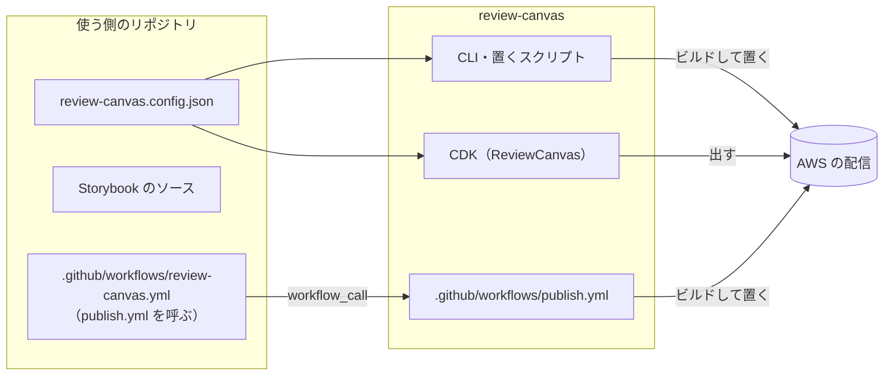

# 使う側のリポジトリでの準備

review-canvas は、Storybook を持つアプリのリポジトリ（以下「使う側」）の外に置いて使います。使う側に足すのは、設定ファイル `review-canvas.config.json` と、置くためのワークフロー（任意）だけです。



## 設定ファイル（`review-canvas.config.json`）

使う側のリポジトリの根に置きます（ほかの場所に置くときは、CLI・ワークフロー・CDK に場所を渡す）。形は JSON Schema（このリポジトリの `review-canvas.config.schema.json`。`api/infrastructure/config/review-canvas-config.ts` の zod の定義から作る）で確かめられます。

```json
{
  "$schema": "https://raw.githubusercontent.com/ShuntaToda/review-canvas/<コミット>/review-canvas.config.schema.json",
  "storybooks": [
    {
      "id": "shop",
      "label": "ショップ",
      "build": "pnpm --dir apps/shop run build-storybook --test",
      "outDir": "apps/shop/storybook-static",
      "widths": [375, 768, 1280],
      "defaultWidth": 375,
      "baseHeight": 812
    },
    {
      "id": "console",
      "label": "運用コンソール",
      "build": "pnpm --dir apps/console run build-storybook --test",
      "outDir": "apps/console/storybook-static",
      "widths": [1024, 1280, 1920],
      "defaultWidth": 1280
    }
  ],
  "excludeTitlePrefixes": ["Components/", "Hooks/"],
  "watchPaths": [
    "apps/",
    "packages/ui/",
    "pnpm-lock.yaml",
    "review-canvas.config.json"
  ]
}
```

| 項目                        | 必須 | 内容                                                                                                                                                         |
| --------------------------- | ---- | ------------------------------------------------------------------------------------------------------------------------------------------------------------ |
| `storybooks[]`              | ○    | キャンバスに並べる Storybook（1〜8 個）。1 つ目が、開いたときのページ                                                                                        |
| `storybooks[].id`           | ○    | 英小文字・数字・`-` の 32 文字まで（`^[a-z0-9][a-z0-9-]{0,31}$`）。URL（`?page=`）・コメントの `source`・置き場（`sb/<ブランチ>/<id>/`）に残る。重ねられない |
| `storybooks[].label`        | ○    | 画面に出す名前（ページの切り替え・コメント一覧・Markdown の見出し）。40 文字まで                                                                             |
| `storybooks[].build`        | ○    | Storybook をビルドするコマンド。設定ファイルのあるディレクトリで、シェルで動かす（`--test` のビルドを推奨）                                                  |
| `storybooks[].outDir`       | ○    | ビルド結果（`index.json`・`iframe.html` のあるディレクトリ）。設定ファイルのあるディレクトリからの相対パス（絶対パス・`..` は使えない）                      |
| `storybooks[].widths`       | ○    | 切り替えられる画面の幅（px。200〜4000 の整数、1〜8 個）                                                                                                      |
| `storybooks[].defaultWidth` | ○    | 既定の幅。`widths` のどれか                                                                                                                                  |
| `storybooks[].baseHeight`   |      | 中身を測る前の画面の高さ（px。既定 800）                                                                                                                     |
| `excludeTitlePrefixes`      |      | 既定では並べないストーリーのタイトルの頭（画面の「部品も表示」で並べる）。既定は無し                                                                         |
| `watchPaths`                |      | push のときに置き直すきっかけのパス（リポジトリの根から。`git diff` に渡す）。ワークフローで push から置き直すなら要る（空だと push の実行は失敗する）       |

- `id` をあとから変えると、古い id のコメントは画面のページに並ばなくなります（データは残り、API・書き出しでは読める）
- 並べる Storybook は、msw・play 関数を使っていてもかまいません（キャンバスが 1 つずつ動かす）。msw のサービスワーカー（`mockServiceWorker.js`）は Storybook の `staticDirs` で配る形にしてください
- Storybook の中身はログインなしで読めます。モックのデータだけを使い、本物の個人情報・秘密を入れないでください

## 手元で並べる

review-canvas を使う側とは別の場所に取り出して `pnpm install` しておき、使う側の設定ファイルを渡して起こします。

```bash
git clone https://github.com/ShuntaToda/review-canvas.git
cd review-canvas && pnpm install && pnpm run docker:up

# 使う側の Storybook をビルドしてから（設定の build のとおり）
node bin/review-canvas.mjs dev --config ../my-app/review-canvas.config.json
```

`--config` を渡すと、`REVIEW_CANVAS_CONFIG`（設定ファイル）と `REVIEW_GIT_DIR`（ブランチ・コミットを読む git。設定ファイルのあるディレクトリ）を付けて `pnpm dev` を動かします。`.env` に書いてもかまいません。

## CLI

`bin/review-canvas.mjs`（`package.json` の `bin`。取り出した場所で `pnpm link --global` すると `review-canvas` で呼べる）。

| コマンド                                        | すること                                                                                                |
| ----------------------------------------------- | ------------------------------------------------------------------------------------------------------- |
| `review-canvas dev [--config]`                  | 手元でキャンバスを起こす                                                                                |
| `review-canvas publish [...]`                   | 動かした場所の git の根（`--repo-root`）の Storybook を設定のとおりにビルドし、いまのブランチとして置く |
| `review-canvas unpublish <ブランチ>`            | ブランチの Storybook を消す                                                                             |
| `review-canvas list`・`is-published <ブランチ>` | 置いてあるブランチの一覧（JSON）・置いてあるか（`true`/`false`）                                        |
| `review-canvas schema`                          | 設定ファイルの JSON Schema を作り直す（review-canvas の開発用）                                         |

置く・消すのオプション（`--profile`・`--stack-name`・`--dry-run` など）は [publishing.md](publishing.md#手元から置く消す) にあります。

## ワークフローから置く

使う側のリポジトリに、次のようなワークフローを置きます（`<コミット>` は review-canvas の 40 桁のコミットの SHA。`uses:` と `review_canvas_ref` に同じものを書く）。

```yaml
# .github/workflows/review-canvas.yml
name: review-canvas

on:
  workflow_dispatch:
    inputs:
      branch:
        description: 置くブランチ（空なら、このワークフローを動かしたブランチ）
        required: false
        type: string
      all:
        description: いま置いてあるブランチを全部置き直す
        required: false
        type: boolean
        default: false
  push:
    branches: ["**"]
  delete:

permissions:
  contents: read

jobs:
  review-canvas:
    uses: ShuntaToda/review-canvas/.github/workflows/publish.yml@<コミット>
    permissions:
      contents: read
      id-token: write
    with:
      review_canvas_ref: <コミット>
      config: review-canvas.config.json
      role_arn: ${{ vars.REVIEW_CANVAS_AWS_ROLE_ARN }}
      main_role_arn: ${{ vars.REVIEW_CANVAS_AWS_MAIN_ROLE_ARN }}
      aws_region: ${{ vars.REVIEW_CANVAS_AWS_REGION || 'ap-northeast-1' }}
      stack_name: ${{ vars.REVIEW_CANVAS_STACK_NAME || 'ReviewCanvas' }}
      default_branch: ${{ vars.REVIEW_CANVAS_DEFAULT_BRANCH }}
      branch: ${{ inputs.branch || '' }}
      all: ${{ inputs.all || false }}
```

| 入力                              | 既定                                  | 内容                                                                                  |
| --------------------------------- | ------------------------------------- | ------------------------------------------------------------------------------------- |
| `review_canvas_ref`               | （必須）                              | 置く手順を取り出す review-canvas のコミット（40 桁の SHA でなければ止める）           |
| `config`                          | `review-canvas.config.json`           | 使う側のリポジトリの根からの設定ファイルの場所                                        |
| `role_arn`                        | 空                                    | 既定のブランチ以外を置くロール（出力 `PublishRoleArn`）。空ならどのジョブも動かさない |
| `main_role_arn`                   | 空                                    | 既定のブランチを置くロール（出力 `PublishMainRoleArn`）                               |
| `aws_region`                      | `ap-northeast-1`                      | スタックのリージョン                                                                  |
| `stack_name`                      | `ReviewCanvas`                        | スタックの名前（置き場はこのスタックの出力から読む）                                  |
| `default_branch`                  | リポジトリの既定のブランチ            | スタックの `DefaultBranch` と同じ値                                                   |
| `environment`・`main_environment` | `review-canvas`・`review-canvas-main` | ジョブの GitHub Environment（ロールの信頼ポリシーと同じ名前）                         |
| `branch`・`all`                   | 空・false                             | workflow_dispatch の入力を渡す                                                        |
| `node_version`・`pnpm_version`    | `24`・`10.24.0`                       | ビルドに使う Node.js・pnpm                                                            |
| `install_command`                 | `pnpm install --frozen-lockfile`      | 使う側のリポジトリで依存を入れるコマンド                                              |

Environment・ロール・変数の用意は [github-aws-permissions.md](github-aws-permissions.md)、動き方は [publishing.md](publishing.md#github-actions-から置く) にあります。

## CDK に組み込む

そのまま出すときは、このリポジトリの CDK アプリ（`pnpm run deploy`。[deploy.md](deploy.md)）を使います。使う側の CDK アプリに組み込むときは、コンストラクト `ReviewCanvas`（`infra/lib/index.ts`）を使います。

```ts
import { Stack, type StackProps } from "aws-cdk-lib";
import type { Construct } from "constructs";
import {
  loadReviewCanvasConfig,
  readSettings,
  ReviewCanvas,
} from "<review-canvas を取り出した場所>/infra/lib";

export class ToolsStack extends Stack {
  constructor(scope: Construct, id: string, props: StackProps) {
    super(scope, id, props);
    const settings = readSettings({
      context: (key) => this.node.tryGetContext(key),
      env: process.env,
    });
    new ReviewCanvas(this, "ReviewCanvas", {
      settings: { ...settings, stackName: this.stackName },
      config: loadReviewCanvasConfig("review-canvas.config.json"),
    });
  }
}
```

- 1 つのスタックに 1 つだけ置けます（出力の名前 `Url`・`StorybookBucket` などを固定するため。置くスクリプトとワークフローはこの名前で読む）
- 画面のビルド結果（`dist-deployed`）は review-canvas の側で `pnpm run build:deployed` してから組み立てます。Lambda のバンドルも review-canvas の `pnpm-lock.yaml` と、review-canvas の根に入れた esbuild で行います（review-canvas を取り出した場所で `pnpm install` しておく）
- `aws-cdk-lib`・`constructs` は使う側と同じ版の 1 つの実体を読むようにしてください（別の実体だと、コンストラクトとして認められない）。たとえば使う側の `package.json` で `"aws-cdk-lib": "link:<review-canvas を取り出した場所>/infra/node_modules/aws-cdk-lib"`（`constructs` も同じ形）にします
- `settings.stackName` はロールの名前の頭とコメントに使います。`protectedAccountIds` の確かめ（`assertDeployAccount`）は、使う側のアプリで呼んでください
