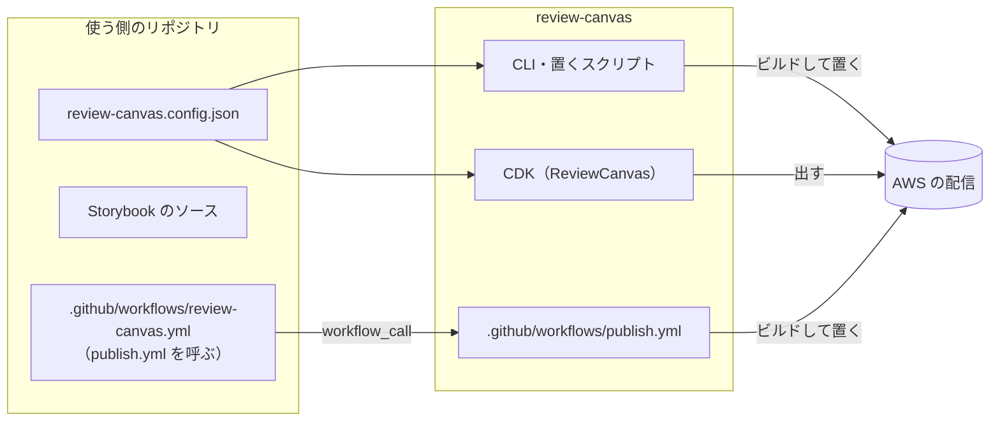

# 使う側のリポジトリでの準備

review-canvas は、Storybook を持つアプリのリポジトリ（以下「使う側」）の外に置いて使います。使う側に足すのは、設定ファイル `review-canvas.config.json` と、置くためのワークフロー（任意）だけです。



## 設定ファイル（`review-canvas.config.json`）

使う側のリポジトリの根に置きます（ほかの場所に置くときは、CLI・ワークフロー・CDK に場所を渡す）。形は JSON Schema（このリポジトリの `review-canvas.config.schema.json`。`api/infrastructure/config/review-canvas-config.ts` の zod の定義から作る）で確かめられます。

```json
{
  "$schema": "https://raw.githubusercontent.com/ShuntaToda/review-canvas/<コミット>/review-canvas.config.schema.json",
  "storybooks": [
    {
      "id": "shop",
      "label": "ショップ",
      "build": "pnpm --dir apps/shop run build-storybook --test",
      "outDir": "apps/shop/storybook-static",
      "widths": [375, 768, 1280],
      "defaultWidth": 375,
      "baseHeight": 812
    },
    {
      "id": "console",
      "label": "運用コンソール",
      "build": "pnpm --dir apps/console run build-storybook --test",
      "outDir": "apps/console/storybook-static",
      "widths": [1024, 1280, 1920],
      "defaultWidth": 1280,
      "baseHeight": 800
    }
  ],
  "excludeTitlePrefixes": ["Components/", "Hooks/"],
  "watchPaths": [
    "apps/",
    "packages/ui/",
    "pnpm-lock.yaml",
    "review-canvas.config.json"
  ]
}
```

| 項目                        | 必須 | 内容                                                                                                                                                                                    |
| --------------------------- | ---- | --------------------------------------------------------------------------------------------------------------------------------------------------------------------------------------- |
| `storybooks[]`              | ○    | キャンバスに並べる Storybook（1〜8 個）。1 つ目が、開いたときのページ                                                                                                                   |
| `storybooks[].id`           | ○    | 英小文字・数字・`-` の 32 文字まで（`^[a-z0-9][a-z0-9-]{0,31}$`）。URL（`?page=`）・コメントの `source`・置き場（`sb/<ブランチ>/<id>/`）に残る。重ねられない                            |
| `storybooks[].label`        | ○    | 画面に出す名前（ページの切り替え・コメント一覧・Markdown の見出し）。40 文字まで                                                                                                        |
| `storybooks[].build`        | ○    | Storybook をビルドするコマンド。設定ファイルのあるディレクトリで、シェルで動かす（`--test` のビルドを推奨）                                                                             |
| `storybooks[].outDir`       | ○    | ビルド結果（`index.json`・`iframe.html` のあるディレクトリ）。設定ファイルのあるディレクトリからの相対パス（絶対パス・`..` は使えない）                                                 |
| `storybooks[].widths`       | ○    | 切り替えられる画面の幅（px）。使う側が決める（決まった候補・既定は無い）。置くときは、この幅ごとに全ストーリーの画像を撮る。1〜10000 の整数を 32 個まで（壊れた値を弾くためだけの上限） |
| `storybooks[].defaultWidth` | ○    | 既定の幅。`widths` のどれか                                                                                                                                                             |
| `storybooks[].baseHeight`   | ○    | 中身を測る前の画面の高さ（px）で、置くときに画像を撮るブラウザの窓の高さでもある。使う側が決める（既定は無い）。1〜16000 の整数                                                         |
| `excludeTitlePrefixes`      |      | 既定では並べないストーリーのタイトルの頭（画面の「部品も表示」で並べる）。既定は無し                                                                                                    |
| `watchPaths`                |      | push のときに置き直すきっかけのパス（リポジトリの根から。`git diff` に渡す）。ワークフローで push から置き直すなら要る（空だと push の実行は失敗する）                                  |

- `id` をあとから変えると、古い id のコメントは画面のページに並ばなくなります（データは残り、API・書き出しでは読める）
- 並べる Storybook は、msw・play 関数を使っていてもかまいません（play 関数を持つストーリーは、キャンバスが 1 つずつ動かす）。msw のサービスワーカー（`mockServiceWorker.js`）は Storybook の `staticDirs` で配る形にしてください
- 画面の幅・高さに、review-canvas が決めた既定はありません。設定の幅のほかの幅で見たい人は、画面の「幅を足す」で自分用の幅を足せます（そのブラウザにだけ覚える。足した幅には画像が無いので、iframe で読み込む）
- Storybook の中身は、何も指定しなければログインなしで読めます（絞るときは下の「[見られる人を絞る](#見られる人を絞るip-制限ログイン連動)」）。絞っても、モックのデータだけを使い、本物の個人情報・秘密を入れないでください

## 手元で並べる

review-canvas を使う側とは別の場所に取り出して `pnpm install` しておき、使う側の設定ファイルを渡して起こします。

```bash
git clone https://github.com/ShuntaToda/review-canvas.git
cd review-canvas && pnpm install && pnpm run docker:up

# 使う側の Storybook をビルドしてから（設定の build のとおり）
node bin/review-canvas.mjs dev --config ../my-app/review-canvas.config.json
```

`--config` を渡すと、`REVIEW_CANVAS_CONFIG`（設定ファイル）と `REVIEW_GIT_DIR`（ブランチ・コミットを読む git。設定ファイルのあるディレクトリ）を付けて `pnpm dev` を動かします。`.env` に書いてもかまいません。

## CLI

`bin/review-canvas.mjs`（`package.json` の `bin`。取り出した場所で `pnpm link --global` すると `review-canvas` で呼べる）。

| コマンド                                        | すること                                                                                                |
| ----------------------------------------------- | ------------------------------------------------------------------------------------------------------- |
| `review-canvas dev [--config]`                  | 手元でキャンバスを起こす                                                                                |
| `review-canvas publish [...]`                   | 動かした場所の git の根（`--repo-root`）の Storybook を設定のとおりにビルドし、いまのブランチとして置く |
| `review-canvas unpublish <ブランチ>`            | ブランチの Storybook を消す                                                                             |
| `review-canvas list`・`is-published <ブランチ>` | 置いてあるブランチの一覧（JSON）・置いてあるか（`true`/`false`）                                        |
| `review-canvas schema`                          | 設定ファイルの JSON Schema を作り直す（review-canvas の開発用）                                         |

置く・消すのオプション（`--profile`・`--stack-name`・`--dry-run` など）は [publishing.md](publishing.md#手元から置く消す) にあります。

## ワークフローから置く

使う側のリポジトリに、次のようなワークフローを置きます（`<コミット>` は review-canvas の 40 桁のコミットの SHA。`uses:` と `review_canvas_ref` に同じものを書く）。review-canvas をフォークして使うときは、`uses:` のリポジトリと `review_canvas_repository` をフォークにそろえます。

```yaml
# .github/workflows/review-canvas.yml
name: review-canvas

on:
  workflow_dispatch:
    inputs:
      branch:
        description: 置くブランチ（空なら、このワークフローを動かしたブランチ）
        required: false
        type: string
      all:
        description: いま置いてあるブランチを全部置き直す
        required: false
        type: boolean
        default: false
  push:
    branches: ["**"]
  delete:

permissions:
  contents: read

jobs:
  review-canvas:
    uses: ShuntaToda/review-canvas/.github/workflows/publish.yml@<コミット>
    permissions:
      contents: read
      id-token: write
    with:
      review_canvas_ref: <コミット>
      config: review-canvas.config.json
      role_arn: ${{ vars.REVIEW_CANVAS_AWS_ROLE_ARN }}
      main_role_arn: ${{ vars.REVIEW_CANVAS_AWS_MAIN_ROLE_ARN }}
      aws_region: ${{ vars.REVIEW_CANVAS_AWS_REGION || 'ap-northeast-1' }}
      stack_name: ${{ vars.REVIEW_CANVAS_STACK_NAME || 'ReviewCanvas' }}
      default_branch: ${{ vars.REVIEW_CANVAS_DEFAULT_BRANCH }}
      branch: ${{ inputs.branch || '' }}
      all: ${{ inputs.all || false }}
```

| 入力                              | 既定                                  | 内容                                                                                  |
| --------------------------------- | ------------------------------------- | ------------------------------------------------------------------------------------- |
| `review_canvas_ref`               | （必須）                              | 置く手順を取り出す review-canvas のコミット（40 桁の SHA でなければ止める）           |
| `review_canvas_repository`        | `ShuntaToda/review-canvas`            | 置く手順を取り出す review-canvas のリポジトリ（`uses:` の `@` の前と同じもの）        |
| `config`                          | `review-canvas.config.json`           | 使う側のリポジトリの根からの設定ファイルの場所                                        |
| `role_arn`                        | 空                                    | 既定のブランチ以外を置くロール（出力 `PublishRoleArn`）。空ならどのジョブも動かさない |
| `main_role_arn`                   | 空                                    | 既定のブランチを置くロール（出力 `PublishMainRoleArn`）                               |
| `aws_region`                      | `ap-northeast-1`                      | スタックのリージョン                                                                  |
| `stack_name`                      | `ReviewCanvas`                        | スタックの名前（置き場はこのスタックの出力から読む）                                  |
| `default_branch`                  | リポジトリの既定のブランチ            | スタックの `DefaultBranch` と同じ値                                                   |
| `environment`・`main_environment` | `review-canvas`・`review-canvas-main` | ジョブの GitHub Environment（ロールの信頼ポリシーと同じ名前）                         |
| `branch`・`all`                   | 空・false                             | workflow_dispatch の入力を渡す                                                        |
| `node_version`・`pnpm_version`    | `24`・`10.24.0`                       | ビルドに使う Node.js・pnpm                                                            |
| `install_command`                 | `pnpm install --frozen-lockfile`      | 使う側のリポジトリで依存を入れるコマンド                                              |

Environment・ロール・変数の用意は [github-aws-permissions.md](github-aws-permissions.md)、動き方は [publishing.md](publishing.md#github-actions-から置く) にあります。

## CDK に組み込む

そのまま出すときは、このリポジトリの CDK アプリ（`pnpm run deploy`。[deploy.md](deploy.md)）を使います。使う側の CDK アプリに組み込むときは、コンストラクト `ReviewCanvas`（`infra/lib/index.ts`）を使います。

```ts
import { Stack, type StackProps } from "aws-cdk-lib";
import type { Construct } from "constructs";
import {
  loadReviewCanvasConfig,
  readSettings,
  ReviewCanvas,
} from "<review-canvas を取り出した場所>/infra/lib";

export class ToolsStack extends Stack {
  constructor(scope: Construct, id: string, props: StackProps) {
    super(scope, id, props);
    const settings = readSettings({
      context: (key) => this.node.tryGetContext(key),
      env: process.env,
    });
    new ReviewCanvas(this, "ReviewCanvas", {
      settings: { ...settings, stackName: this.stackName },
      config: loadReviewCanvasConfig("review-canvas.config.json"),
    });
  }
}
```

- 1 つのスタックに 1 つだけ置けます（出力の名前 `Url`・`StorybookBucket` などを固定するため。置くスクリプトとワークフローはこの名前で読む）
- 画面のビルド結果（`dist-deployed`）は review-canvas の側で `pnpm run build:deployed` してから組み立てます。Lambda のバンドルも review-canvas の `pnpm-lock.yaml` と、review-canvas の根に入れた esbuild で行います（review-canvas を取り出した場所で `pnpm install` しておく）
- `aws-cdk-lib`・`constructs` は使う側と同じ版の 1 つの実体を読むようにしてください（別の実体だと、コンストラクトとして認められない）。たとえば使う側の `package.json` で `"aws-cdk-lib": "link:<review-canvas を取り出した場所>/infra/node_modules/aws-cdk-lib"`（`constructs` も同じ形）にします
- `settings.stackName` はロールの名前の頭とコメントに使います。`protectedAccountIds` の確かめ（`assertDeployAccount`）は、使う側のアプリで呼んでください

## 見られる人を絞る（IP 制限・ログイン連動）

何も指定しなければ、キャンバスの画面と Storybook のファイル・画像は、URL を知っていればだれでも読めます（コメントの読み書きはログインが要る）。Storybook を関係者の外に見せたくないときは、構築するときに次の 2 つを選べます（どちらか片方でも、両方でも）。値は、ほかの設定と同じく環境変数か CDK のコンテキストで渡します（[deploy.md](deploy.md#設定)）。指定しなければ、今までと同じ構成のままです。

|                                                  | IP 制限                                                                                                 | ログイン連動（独自ドメイン）                                                                                                                            |
| ------------------------------------------------ | ------------------------------------------------------------------------------------------------------- | ------------------------------------------------------------------------------------------------------------------------------------------------------- |
| 止めるもの                                       | 許可していない IP からの、キャンバスの画面・API・Storybook・画像・目録のすべて（403）                   | ログインしていない人の、Storybook のファイル・画像・目録（403）。キャンバスの画面のファイルは読める（中身は持たない。API は今までどおりログインが要る） |
| 向いているとき                                   | 見る人が、決まった拠点・VPN から開く                                                                    | 見る人の場所が決まっていない。独自ドメインと証明書を用意できる                                                                                          |
| 要るもの                                         | 許可する IP の範囲                                                                                      | 同じ親ドメインの下の 2 つのドメイン・us-east-1 の ACM の証明書・署名用の鍵の対                                                                          |
| 費用の目安（月。AWS の料金表で確かめてください） | Web ACL 5 USD ＋ ルール 1 USD × 1〜2（IPv4・IPv6）＋ 要求 100 万件あたり 0.60 USD                       | 追加の料金はほぼ無し（ACM の公開証明書・キーグループ・SSM の標準のパラメータは無料。Route 53 のホストゾーンを新しく作るなら 0.50 USD）                  |
| 気を付けること                                   | AI・CI（M2M の client）や GitHub Actions の外から API を呼ぶ道具も、許可した IP からでないと 403 になる | クッキーを付ける親ドメインの下の、ほかのホストにもクッキーが送られる（下の「ドメインの決め方」）                                                        |

### IP 制限（AWS WAF）

```bash
REVIEW_CANVAS_ALLOWED_IP_CIDRS=203.0.113.0/24,2001:db8:1234::/48 \
pnpm run deploy --profile <プロファイル>
```

- `REVIEW_CANVAS_ALLOWED_IP_CIDRS`（`-c allowedIpCidrs=`）に、許可する IP の範囲（CIDR。IPv4・IPv6。カンマ区切り）を渡すと、それだけを通す Web ACL を作り、キャンバスと Storybook の 2 つの配信に付けます。1 つの IP は `/32`（IPv6 は `/128`）で書きます。`/0` は使えません
- IPv6 でつながる人がいるなら、IPv6 の範囲も入れてください（CloudFront は IPv6 でも受けるので、IPv4 だけを許可すると、IPv6 でつないだ人が 403 になります）
- CloudFront 用の Web ACL は us-east-1 にしか作れません。出し先が us-east-1 ならスタックは 1 つのまま、ほかのリージョンなら Web ACL だけのスタック `<スタック名>-Waf` を us-east-1 に一緒に作ります（`pnpm run deploy`・`destroy` は 2 つとも扱います）。その場合は、us-east-1 でも一度 `cdk bootstrap aws://<アカウント ID>/us-east-1 --profile <プロファイル>` をしておいてください。ARN は CDK のリージョンをまたぐ参照で渡すので、2 つのリージョンに受け渡し用の小さなリソース（Lambda と SSM のパラメータ）が増えます
- 自分で用意した Web ACL を使うときは、範囲の代わりに `REVIEW_CANVAS_WEB_ACL_ARN`（`-c webAclArn=`。CloudFront 用＝us-east-1 の `global` のもの）を渡します。Web ACL は作らず、渡したものを 2 つの配信に付けます（範囲と同時には指定できません）
- 範囲を変えるときは、値を変えて出し直します。やめるときは、指定を外して出し直します
- 使う側の CDK アプリに `ReviewCanvas` を組み込むときは、`settings.network.webAclArn` に Web ACL の ARN を渡すか、us-east-1 のスタックなら `settings.network.allowedIpCidrs` を渡します。us-east-1 以外で範囲から作るときは、`ReviewCanvasWafStack`（`infra/lib/index.ts`）を us-east-1 に置き、その `webAclArn` を渡します（両方のスタックに `crossRegionReferences: true`）

### ログイン連動（独自ドメインと署名付きクッキー）

キャンバスにログインした人だけが、Storybook の配信を読めるようにします。キャンバスがログインのあとに API を呼ぶと、API が CloudFront の署名付きクッキーをブラウザに付け、Storybook の配信は、そのクッキーの無い要求を 403 にします。

**ドメインの決め方**: キャンバス用と Storybook 用の 2 つのドメインを、同じ親ドメインの下に用意します（例: `canvas.review.example.com` と `sb.review.example.com`）。クッキーは 2 つに共通の親（例では `review.example.com`）に付くので、その下のどのホストにも送られます。ほかの用途のホストが無い、専用の親ドメインにしてください（`canvas.example.com` と `sb.example.com` にすると、`example.com` の下の全部のホストにクッキーが送られます）。2 つを同じドメインにすることはできません（Storybook のコードからログインのトークンを守るため、オリジンを分けています）。

1. us-east-1 の ACM で、2 つのドメインを含む証明書（例: `*.review.example.com`）を発行する
2. 署名用の鍵の対（RSA 2048）を作り、秘密鍵を、出し先のリージョンの SSM パラメータストアに SecureString で入れる。秘密鍵のファイルは、入れたら消す（リポジトリに置かない）

   ```bash
   openssl genrsa -out storybook-cookie-key-1.pem 2048
   openssl rsa -pubout -in storybook-cookie-key-1.pem -out storybook-cookie-key-1.pub.pem
   aws ssm put-parameter --name /review-canvas/storybook-cookie-key-1 --type SecureString \
     --value file://storybook-cookie-key-1.pem --profile <プロファイル>
   rm storybook-cookie-key-1.pem
   ```

3. 5 つの値を付けて出す

   ```bash
   REVIEW_CANVAS_CANVAS_DOMAIN=canvas.review.example.com \
   REVIEW_CANVAS_STORYBOOK_DOMAIN=sb.review.example.com \
   REVIEW_CANVAS_CERTIFICATE_ARN=arn:aws:acm:us-east-1:123456789012:certificate/00000000-0000-4000-8000-000000000000 \
   REVIEW_CANVAS_STORYBOOK_PUBLIC_KEY_FILES=./storybook-cookie-key-1.pub.pem \
   REVIEW_CANVAS_STORYBOOK_PRIVATE_KEY_PARAMETER=/review-canvas/storybook-cookie-key-1 \
   pnpm run deploy --profile <プロファイル>
   ```

4. DNS を向ける。Route 53 のホストゾーンを `REVIEW_CANVAS_HOSTED_ZONE_ID`・`REVIEW_CANVAS_HOSTED_ZONE_NAME`（例: `Z0123456789ABCDEFGHIJ`・`example.com`）で渡すと、2 つのドメインのレコード（A・AAAA のエイリアス）を作ります。渡さなければ、出力の `DistributionDomainName`・`StorybookDistributionDomainName` へ、自分の DNS で CNAME を張ります
5. Auth0 の Application の Allowed Callback URLs・Allowed Logout URLs・Allowed Web Origins を、新しい `Url`（`https://canvas.review.example.com`）に変える（[auth0.md](auth0.md)）。GitHub Actions・手元から置く手順は変わりません（置き場は同じ）

- 5 つの値（2 つのドメイン・証明書・公開鍵のファイル・秘密鍵のパラメータの名前）は、そろえて渡します（一部だけだと組み立てで止まる）。どれも渡さなければ、今までと同じ構成です
- 鍵は使う側が作ります。CDK が作るのは、公開鍵（CloudFront の公開鍵とキーグループ）だけで、秘密鍵は CloudFormation にも CDK の出力にも出ません。秘密鍵を読めるのは API の Lambda だけです（`ssm:GetParameter` を、そのパラメータにだけ付ける）。SecureString を自分の KMS の鍵で暗号化したときは、Lambda のロールに `kms:Decrypt` を足してください（既定の鍵 `alias/aws/ssm` なら要りません）
- クッキーの期限は 30 分です。画面は、開いたとき・ウィンドウに戻ったとき・10 分ごとにもらい直すので、開いているあいだは切れません。長く閉じていたタブに戻った直後は、もらい直すまでの一瞬、iframe・画像が 403 になることがあります（読み直すと出ます）
- **ログアウト**すると、画面は API を呼んでクッキーをブラウザから消してからログアウトします。CloudFront の署名付きクッキーは、発行した後にサーバーの側から取り消せないので、消す前に写し取られたクッキーは期限（最長 30 分）まで使えます。すぐに全員の分を止めたいときは、下の手順で鍵を入れ替え、古い公開鍵を残さずに出します
- **鍵を入れ替える**とき: 新しい鍵の対を作り、秘密鍵を別の名前のパラメータ（例: `/review-canvas/storybook-cookie-key-2`）に入れ、`REVIEW_CANVAS_STORYBOOK_PUBLIC_KEY_FILES=<新しい公開鍵>,<前の公開鍵>`・`REVIEW_CANVAS_STORYBOOK_PRIVATE_KEY_PARAMETER=<新しい名前>` で出します（先頭の公開鍵が、署名に使う鍵。2 つ目からは、前の鍵で署名したクッキーを期限まで通すために残す）。30 分より後に、前の公開鍵を外して出し直し、前のパラメータを消します。API は秘密鍵を Lambda の実行環境のあいだ持つので、同じ名前のパラメータの中身だけを書き換えても、すぐには切り替わりません（名前ごと変える）
- AI・CI（M2M の client）は API だけを呼ぶので、クッキーは要りません。Storybook のファイルを道具から直に読むことは、クッキーが無いのでできなくなります
- やめるときは、5 つの値を外して出し直します（配信のドメインは `*.cloudfront.net` に戻る。Auth0 の URL も戻す）

仕組みと、守れること・守れないことは [security.md](security.md#見られる人を絞る選べる仕組み) にあります。
