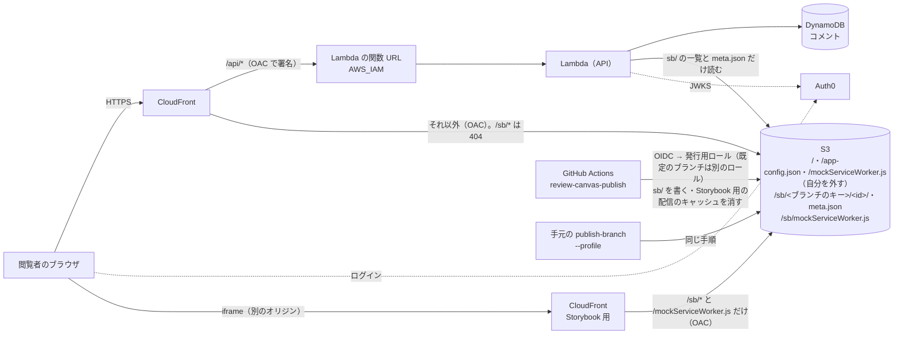

# セキュリティの考え方

review-canvas は、ブランチごとに誰でも置き換えられる Storybook（ストーリーのコード）を、ログインしたキャンバスの中に並べます。ストーリーのコードを信頼しない前提で、次のように分けています。

## 配信の構成

- キャンバス・API と Storybook は、同じバケットを別々の CloudFront の配信（別のオリジン）で配ります（バケットは 1 つ。OAC も 1 つを共有）。ストーリーのコード（ブランチごとに誰でも置き換えられる）を、ログインのトークンを持つ画面と同じオリジンで動かさないためです
  - バケットのポリシーでも分けます。画面の配信は `sb/*` を読めず、Storybook 用の配信は `sb/*` の外を読めません（Deny。配信の関数はパスの字面で分けるだけなので、`/sb%2F...` のような書き方で抜けても、ここで止まる）。画面の配信の関数も、Storybook 用の配信の関数も、`%` か `//` を含むパスは 404 にします
  - 画面の配信は `/sb/*` を 404 にし、`/mockServiceWorker.js` には自分を外すだけのサービスワーカー（`public/mockServiceWorker.js`）を置きます（画面のオリジンに msw が登録されていても外すため）
  - Storybook 用の配信は `/sb/*` と `/mockServiceWorker.js`（S3 の `sb/mockServiceWorker.js` を返す。msw はオリジン直下でないと効かない）だけを配り、ほかは 404 です。サービスワーカーの読み込み（`Service-Worker` ヘッダーの付いた要求）は `/mockServiceWorker.js` のほかは 403 にします（ブランチの Storybook が `/sb/` の scope で自分のサービスワーカーを登録し、ほかのブランチの画面を差し替えないように）。応答には CORS（`Access-Control-Allow-Origin: *`。マネージドの CORS-With-Preflight ではなく CORS-AllowAllOrigins）を付けます（画面が `index.json`・`meta.json` を読むため。ログインの情報は送らない）
  - 画面は Storybook のオリジンを `/app-config.json` の `storybookOrigin`（デプロイの出力 `StorybookUrl`）から読みます
- API の関数 URL は CloudFront（OAC）からだけ呼べます。ログインの確かめは API が Auth0 のアクセストークンで行います。画面・Storybook のファイルそのものはログインなしで読めます（中身はモックのデータだけ。URL を関係者の外に渡さない）
- 画面は Auth0 の値をビルドに埋め込まず、デプロイのときに置く `/app-config.json` から読みます
- 名前にハッシュを持つファイル（画面の `/assets/` と、Storybook の配信の `/sb/<ブランチのキー>/<id>/assets/`）は `Cache-Control: public, max-age=31536000, immutable` で長く（1 年）キャッシュさせ、ほか（`index.html`・Storybook の `iframe.html`・`index.json`・`sb-manager/`・`meta.json`・`app-config.json` 等）は `no-cache` で使うたびに確かめ直させます（Storybook を入れ替えた後に、古い `iframe.html` が消えたファイルを読みに行かないように）。Storybook の分は置くスクリプトが付けます
- 出してはいけないアカウント（`protectedAccountIds`）へは、アプリから組み立てる経路で出し先のアカウントを確かめて止めます（[deploy.md](deploy.md)）。組み立て済みの `cdk.out` を `cdk deploy --app cdk.out` で渡す経路は確かめないので使わないでください
- WAF・独自ドメイン・アクセスログ・アラームは持ちません。`cdk destroy` でバケットごと消え、コメントのテーブルだけ残ります（要らなければ手で消す）。消した後に出し直すと新しいテーブルを作るため、残したテーブルのコメントは画面に出ません（出し直しても読めるのは新しいテーブルの分だけ）

## Storybook との橋渡し（`src/features/review/bridge/`）

Storybook は画面と別のオリジンで配るので、画面は iframe の中の DOM を直に読みません。配るとき（置くスクリプト・手元のサーバー）に、各 Storybook の `iframe.html` へ橋渡しの `<script>` を 1 つだけ差し込み（`inject.ts`。印のコメントで囲み、何度差し込んでも 1 つ）、画面とは `postMessage` だけでやり取りします（`protocol.ts`）。

- 画面 → 橋渡し: `hello`（つなぐ）・`mode`（操作モードか）・`blur`（中のフォーカスを外す）・`capture`（押した位置の要素の手がかりを集める）・`locate`（ピンの要素を探す）
- 橋渡し → 画面: `ready`・`render`（描画の段階・play 関数の有無）・`size`（高さ）・`focusin`・`blur`・`keydown`/`keyup`（利用者のキーだけ。play 関数の打つキーは伝えない）・`captured`・`located`
- どちらも、相手のオリジン（画面は `app-config.json` の `storybookOrigin`、橋渡しは差し込むときに `data-canvas-origin` で渡した画面のオリジン）と相手の window（iframe の window・親の window）を確かめ、知らない形の知らせは捨てます。橋渡しは、最初に `hello` をくれた画面のオリジンとだけやり取りします
- ストーリーの iframe には `sandbox`（`allow-scripts allow-same-origin allow-forms allow-popups allow-popups-to-escape-sandbox allow-modals`）を付け、`allow-top-navigation` は渡しません。ストーリーのコードが `top.location` で親のタブ（キャンバス）を別のページへ移せないようにするためです（`allow-same-origin` は Storybook の配信のオリジンのまま動かすため）
- 集めた手がかりは、画面・サーバーの両方で形と 8KB の上限を確かめます。入力欄の値は持ちません
- 橋渡しの無い Storybook（橋渡しを差し込まずに置いたもの）は、つながらないまま 4 秒で読み込みの順番を譲り、画面の名前の横に「置き直しが必要」を出します（ピンは置いたときの位置に出す）。同じ置き場の 2 枚目からは、返事を待たずに順番を譲ります
- 高さは橋渡しが測って知らせます。幅を切り替えたとき・iframe を付け直したときは、画面から測り直しを頼みます（見えている範囲の外の iframe には大きさの変化が届かないため）。画面の高さ（`100vh` など）に合わせて伸びるストーリーは、知らせた高さで iframe が伸びると中身もまた伸びるので、画面の高さに引きずられた伸びは知らせません（`bridge/measure.ts`）。知らせずにいるあいだは、iframe の中の縦のスクロールバーを隠します
- 中身の高さは、body の子要素の下端（下の余白まで。画面に固定した要素は数えない）で測ります（`scrollHeight` は iframe の高さより小さくならず、play 関数で一度伸びた画面が縮んでも分からないため）。子要素の内からはみ出した絶対配置の要素は数えません
- 幅を切り替えた・iframe を付け直したあとは、いまの幅で一度測ってもらうまで iframe を既定の高さ（`baseHeight`）にしておきます（覚えておいた高さのまま測ると、画面の高さに合わせて伸びるストーリーが行き来のたびに伸びるため。`model/frame-height.ts`）。キャンバスの枠は覚えておいた高さのままです。橋渡しは測ったときの幅も送り、前の幅で測った知らせは捨てます

## ログインと使える人

- API は Auth0 のアクセストークン（RS256・JWKS で確かめる）を `X-Authorization` で受けます。トークンに載ったメールアドレスが確かめ済み（`email_verified`）で、許したドメイン・メールアドレス（既定は `*`）に当たる人だけが使えます（[auth0.md](auth0.md)）
- 書いた人・解決した人はトークンから決め、リクエストでは受け取りません。本文の編集・削除は書いた本人（トークンの `sub`）だけです
- 手元の擬似ログイン（署名の無いトークン）は、`STAGE_NAME=LOCAL` かつ `AUTH_MODE=dev` のときだけ受け付けます。デプロイ先のビルドに擬似ログインのコードが入っていないことを CI が確かめます（`check:deployed-bundle`）
- 手元のサーバーは `127.0.0.1` だけで待ち受けます（擬似ログインは誰でも名乗れるため）

## 置くときの守り

- ビルド（置くブランチのコードを動かす）と置く（AWS の資格情報を持つ）はジョブを分け、資格情報を持つジョブでは既定のブランチ以外のコードを動かしません。既定のブランチは、既定のブランチからだけ動く Environment のジョブが、自分のチェックアウトからビルドします（[publishing.md](publishing.md#github-actions-から置く)）
- 発行用ロールは既定のブランチ用とそれ以外で分け、それ以外のロールからは既定のブランチの置き場と共有のサービスワーカーへの書き込みを Deny します（[github-aws-permissions.md](github-aws-permissions.md)）
- 設定ファイルの `outDir` は相対パスに限り、置くチェックアウトの外を指していたら止めます（置くブランチの設定でリポジトリの外のファイルを上げさせない）。Storybook の `id` も決まった形（英小文字・数字・`-` の 32 文字まで）に限ります
- 置き場に書いてよいのは Storybook のビルド結果（モックのデータ）だけです。画面・Storybook のファイルはログインなしで読めるので、本物の個人情報・秘密をストーリーに入れないでください
