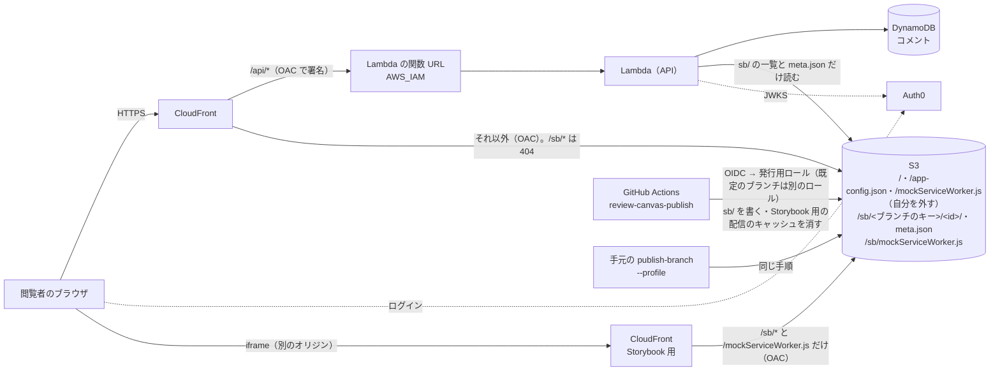

# セキュリティの考え方

review-canvas は、ブランチごとに誰でも置き換えられる Storybook（ストーリーのコード）を、ログインしたキャンバスの中に並べます。ストーリーのコードを信頼しない前提で、次のように分けています。

## 配信の構成

- キャンバス・API と Storybook は、同じバケットを別々の CloudFront の配信（別のオリジン）で配ります（バケットは 1 つ。OAC も 1 つを共有）。ストーリーのコード（ブランチごとに誰でも置き換えられる）を、ログインのトークンを持つ画面と同じオリジンで動かさないためです
  - バケットのポリシーでも分けます。画面の配信は `sb/*` を読めず、Storybook 用の配信は `sb/*` の外を読めません（Deny。配信の関数はパスの字面で分けるだけなので、`/sb%2F...` のような書き方で抜けても、ここで止まる）。画面の配信の関数も、Storybook 用の配信の関数も、`%` か `//` を含むパスは 404 にします
  - 画面の配信は `/sb/*` を 404 にし、`/mockServiceWorker.js` には自分を外すだけのサービスワーカー（`public/mockServiceWorker.js`）を置きます（画面のオリジンに msw が登録されていても外すため）
  - Storybook 用の配信は `/sb/*` と `/mockServiceWorker.js`（S3 の `sb/mockServiceWorker.js` を返す。msw はオリジン直下でないと効かない）だけを配り、ほかは 404 です。サービスワーカーの読み込み（`Service-Worker` ヘッダーの付いた要求）は `/mockServiceWorker.js` のほかは 403 にします（ブランチの Storybook が `/sb/` の scope で自分のサービスワーカーを登録し、ほかのブランチの画面を差し替えないように）。応答には CORS（`Access-Control-Allow-Origin: *`。マネージドの CORS-With-Preflight ではなく CORS-AllowAllOrigins）を付けます（画面が `index.json`・`meta.json` を読むため。ログインの情報は送らない）
  - 画面は Storybook のオリジンを `/app-config.json` の `storybookOrigin`（デプロイの出力 `StorybookUrl`）から読みます
- API の関数 URL は CloudFront（OAC）からだけ呼べます。ログインの確かめは API が Auth0 のアクセストークンで行います。画面・Storybook のファイルそのものは、何も指定しなければログインなしで読めます（中身はモックのデータだけ。URL を関係者の外に渡さない。絞るときは下の「見られる人を絞る」）
- 画面の配信（画面と `/api/*`）の応答には、`Content-Security-Policy: frame-ancestors 'none'`・`X-Frame-Options: DENY`（ほかのページの iframe に入れさせない）・`Strict-Transport-Security`（1 年）・`X-Content-Type-Options: nosniff`・`Referrer-Policy: strict-origin-when-cross-origin` を付けます。Storybook 用の配信はキャンバスの iframe に入るので付けません
- 画面は Auth0 の値をビルドに埋め込まず、デプロイのときに置く `/app-config.json` から読みます
- 名前にハッシュを持つファイル（画面の `/assets/` と、Storybook の配信の `/sb/<ブランチのキー>/<id>/assets/`・置くときに撮った画像 `/sb/<ブランチのキー>/<id>/review-canvas-shots/`）は `Cache-Control: public, max-age=31536000, immutable` で長く（1 年）キャッシュさせ、ほか（`index.html`・Storybook の `iframe.html`・`index.json`・`sb-manager/`・`meta.json`・`app-config.json` 等）は `no-cache` で使うたびに確かめ直させます（Storybook を入れ替えた後に、古い `iframe.html` が消えたファイルを読みに行かないように）。Storybook の分は置くスクリプトが付けます
- 置くときに撮るストーリーの画像は、Storybook と同じ置き場に置くので、既定では Storybook と同じくログインなしで読めます（写るのはモックのデータだけ、という前提は Storybook と同じ）。画像の目録（`review-canvas-shots.json`）は置くブランチが書けるので、キャンバスは形を確かめ、画像の場所は置き場の直下の `.png` だけ（`..`・別のオリジンは捨てる）、幅・高さは上限までの整数だけを受け付けます。置くスクリプトも、目録に載っている・リンクでない・中身が PNG のファイルだけを置きます。ワークフローでは、置くブランチのストーリーをブラウザで動かす撮影を、AWS の資格情報を持たないジョブで行います
- 出してはいけないアカウント（`protectedAccountIds`）へは、アプリから組み立てる経路で出し先のアカウントを確かめて止めます（[deploy.md](deploy.md)）。組み立て済みの `cdk.out` を `cdk deploy --app cdk.out` で渡す経路は確かめないので使わないでください
- アクセスログ・アラームは持ちません。WAF・独自ドメインは、設定を渡したときだけ作ります（下の「見られる人を絞る」）。`cdk destroy` でバケットごと消え、コメントのテーブルだけ残ります（要らなければ手で消す）。消した後に出し直すと新しいテーブルを作るため、残したテーブルのコメントは画面に出ません（出し直しても読めるのは新しいテーブルの分だけ）

## 見られる人を絞る（選べる仕組み）

どちらも、設定を渡したときだけ作ります（[host-setup.md](host-setup.md#見られる人を絞るip-制限ログイン連動)）。渡さなければ、上の構成のままです。

- **IP 制限（AWS WAF）**: 許可した IP の範囲だけを通す Web ACL（既定は Block）を、キャンバスと Storybook の 2 つの配信に付けます。許可していない IP には、画面・API・Storybook・画像・目録のどれも 403 です（配信はエラーの応答を書き換えない）。Lambda の関数 URL と S3 は、もとから CloudFront（OAC）からしか読めないので、配信を通らない道はありません。止めるのは IP だけで、許可した拠点の中のだれが見るかは分けません
- **ログイン連動（CloudFront の署名付きクッキー）**: Storybook の配信に、信頼するキーグループ（公開鍵）を付け、署名付きクッキーの無い・期限の切れた・署名の合わない要求を CloudFront が 403 にします。クッキーは、ログインした人（API がアクセストークンを確かめた人。使ってよい人の決まりも同じ）が `POST /api/storybook-session` を呼んだときだけ、API が付けます
  - クッキーは `HttpOnly`・`Secure`・`SameSite=Lax` で、2 つのドメインに共通の親ドメインに付けます。期限は 30 分で、読めるのは Storybook の配信の下だけ（独自のポリシーの `Resource` が `https://<Storybook のドメイン>/*`）です
  - **オリジンの分け方は変えていません**。クッキーは `HttpOnly` なので、ストーリーのコードからは読めません（`document.cookie` に出ない）。クッキーが通すのは Storybook の配信（静的なファイル）だけで、**API はクッキーでは認証しません**（今までどおり `X-Authorization` のアクセストークンだけを見る）。ストーリーのコードが、クッキーの付いた要求をキャンバスのオリジンの API へ送っても、トークンが無いので 401 です。ログインのトークンは、キャンバスのオリジンのスクリプトだけが持ちます
  - クッキーは親ドメインの下のどのホストにも送られます。そのため親ドメインは、2 つのドメインから自動では決めず、使う側が `REVIEW_CANVAS_COOKIE_DOMAIN` で明示します。review-canvas 専用のサブドメイン（例: `review.example.com` の下に `canvas` と `sb` だけ）にしてください。登録しているドメインそのもの（`example.com`。ゾーンの頂点）にすると、兄弟のホスト（`www.example.com` など）すべてに届き、そのホストの持ち主・そこで動くスクリプトの置き主が、30 分のあいだ Storybook を読めるクッキーを受け取ります
  - **同じサイトにしたことで残る制約**（独自ドメインでは、キャンバスと Storybook が同じ親ドメインの下＝同じサイトになる。既定の `*.cloudfront.net` の 2 つは別のサイト）:
    - ストーリーのコードは、署名付きクッキーを読めませんが、**親ドメインにクッキーを書く**ことはできます（`document.cookie = "...; Domain=<親ドメイン>"`）。大きなクッキーをたくさん書いて、キャンバス・API への要求をヘッダーの大きさの上限で失敗させる（cookie bombing）・署名付きクッキーと同じ名前のクッキーを書いて Storybook を読めなくする、という妨害ができます（そのブラウザだけ。クッキーを消すと直る。トークンやコメントは読めない）。置けるブランチを信頼できる人に限る前提は変わりません
    - クッキーが通すのは Storybook の配信の全部（`/*`）です。あるブランチのストーリーのコードは、見ている人のクッキーで、**ほかのブランチの Storybook のファイルを読めます**（同じオリジンなので、連動していないときも読める。ログインした人が見られる範囲は超えない）
  - AI・CI（M2M の client）にはクッキーを出しません（`POST /api/storybook-session` は 403）。クッキーは、ブラウザで見る人のためのものです
  - Storybook の配信の CORS は、許可するオリジンをキャンバスのドメインだけにし、`Access-Control-Allow-Credentials: true` を付けます（資格情報つきでは `*` を使えない）。キャンバスは、一覧（`index.json`）・画像の目録をクッキーを付けて（`credentials: "include"`）読みます。連動していないときは、今までどおり `*` で、何も付けずに読みます
  - 署名用の秘密鍵は、使う側が SSM パラメータストアの SecureString に入れ、API の Lambda だけが読みます（CloudFormation のテンプレート・出力には出ない）。CloudFront の署名付きクッキーは、発行した後に取り消せません。ログアウトではブラウザから消すだけで、写し取られたクッキーは期限まで使えます。全員の分をすぐ止めるには、鍵を入れ替えて古い公開鍵を外します
  - キャンバスの画面のファイル（`index.html`・`app-config.json` など）は、ログイン連動でもログインなしで読めます（コメントも Storybook の中身も持たない。ログインの画面を出すために要る）。これも閉じたいときは IP 制限を合わせて使います

## Storybook との橋渡し（`src/features/review/bridge/`）

Storybook は画面と別のオリジンで配るので、画面は iframe の中の DOM を直に読みません。配るとき（置くスクリプト・手元のサーバー）に、各 Storybook の `iframe.html` へ橋渡しの `<script>` を 1 つだけ差し込み（`inject.ts`。印のコメントで囲み、何度差し込んでも 1 つ）、画面とは `postMessage` だけでやり取りします（`protocol.ts`）。

- 画面 → 橋渡し: `hello`（つなぐ）・`mode`（操作モードか）・`blur`（中のフォーカスを外す）・`capture`（押した位置の要素の手がかりを集める）・`locate`（ピンの要素を探す）
- 橋渡し → 画面: `ready`・`render`（描画の段階・play 関数の有無）・`size`（高さ）・`focusin`・`blur`・`keydown`/`keyup`（利用者のキーだけ。play 関数の打つキーは伝えない）・`captured`・`located`
- どちらも、相手のオリジン（画面は `app-config.json` の `storybookOrigin`、橋渡しは差し込むときに `data-canvas-origin` で渡した画面のオリジン）と相手の window（iframe の window・親の window）を確かめ、知らない形の知らせは捨てます。橋渡しは、最初に `hello` をくれた画面のオリジンとだけやり取りします
- ストーリーの iframe には `sandbox`（`allow-scripts allow-same-origin allow-forms allow-popups allow-popups-to-escape-sandbox allow-modals allow-downloads`）を付け、`allow-top-navigation` は渡しません。ストーリーのコードが `top.location` で親のタブ（キャンバス）を別のページへ移せないようにするためです（`allow-same-origin` は Storybook の配信のオリジンのまま動かすため。`allow-downloads` はストーリーのダウンロードの操作を試せるようにするため）
  - ブラウザ（Chrome など）は `allow-scripts` と `allow-same-origin` を一緒に付けると「sandbox を抜けられる」と警告します。これは iframe の中身が親と同じオリジンのときの話で、Storybook は画面と別のオリジンで配るため、中のコードは親の DOM に触れず、sandbox の属性も外せません
- 集めた手がかりは、画面・サーバーの両方で形と 8KB の上限を確かめます。入力欄の値は持ちません
- 橋渡しの無い Storybook（橋渡しを差し込まずに置いたもの）は、つながらないまま 4 秒で読み込みの順番を譲り、画面の名前の横に「一部の機能が使えません」を出します（ピンは置いたときの位置に出す）。同じ置き場の 2 枚目からは、返事を待たずに順番を譲ります
- 高さは橋渡しが測って知らせます。幅を切り替えたとき・iframe を付け直したときは、画面から測り直しを頼みます（見えている範囲の外の iframe には大きさの変化が届かないため）。画面の高さ（`100vh` など）に合わせて伸びるストーリーは、知らせた高さで iframe が伸びると中身もまた伸びるので、画面の高さに引きずられた伸びは知らせません（`bridge/measure.ts`）。知らせずにいるあいだは、iframe の中の縦のスクロールバーを隠します
- 中身の高さは、body の子要素の下端（下の余白まで。画面に固定した要素は数えない）で測ります（`scrollHeight` は iframe の高さより小さくならず、play 関数で一度伸びた画面が縮んでも分からないため）。子要素から中身が下へはみ出している（高さを画面に合わせた入れ物（`height: 100vh`）の中の長い中身や文章など）ときは、中へ降りて、はみ出した要素と文字の下端も数えます（はみ出した中身の下には余白を足しません。Chromium のページの高さ（撮影の画像の高さ）も、はみ出した中身の下に先祖の余白を足さないためです）。どれも要素の矩形で測るので、画面の高さが変わっても、同じ中身なら同じ高さになります（画面の高さで測り方が変わると、知らせた高さを iframe に付けるたびに測った高さが行き来するため）。子要素の内の絶対配置の要素と、スクロール・切り取りをする入れ物（`overflow-y` が `visible` でない）の中身は数えません。中へ降りて数える要素と文字の数には上限（`MAX_MEASURED_NODES`。空白だけの文字は数えない）があり、橋渡しと撮影で同じ上限を使います。body に余白のある画面（Storybook の layout `padded`）の 100vh の入れ物は、iframe を伸ばすと余白の分だけ伸びるので、画像から動く画面に切り替えた後に枠が余白の分だけ高くなることがあります
- 幅を切り替えた・iframe を付け直したあとは、いまの幅で一度測ってもらうまで iframe を既定の高さ（`baseHeight`）にしておきます（覚えておいた高さのまま測ると、画面の高さに合わせて伸びるストーリーが行き来のたびに伸びるため。`model/frame-height.ts`）。キャンバスの枠は覚えておいた高さのままです。橋渡しは測ったときの幅も送り、前の幅で測った知らせは捨てます。撮った画像を出しているあいだは、測った高さを枠に渡さずに持っておき（iframe はその高さで付けます）、動く画面に切り替わったときに 1 回だけ合わせます。切り替える前に測り直しを頼み、その答えの高さに合わせます（答えが来なければ、それまでに測った最後の高さ）。読み込みの途中の高さで、枠と下に並ぶ画面が跳ねないようにするためです

## ログインと使える人

- API は Auth0 のアクセストークン（RS256・JWKS で確かめる）を `X-Authorization` で受けます。トークンに載ったメールアドレスが確かめ済み（`email_verified`）で、許したドメイン・メールアドレス（既定は `*`）に当たる人だけが使えます（[auth0.md](auth0.md)）
- 書いた人・解決した人・「AI 修正済み」の印を付けた人はトークンから決め、リクエストでは受け取りません。本文の編集・削除は書いた本人（トークンの `sub`）だけです
- AI・CI が人の代わりに呼ぶときは、Auth0 の Machine to Machine（client credentials）のトークンを使います。既定ではどの client も通さず、設定（`REVIEW_CANVAS_M2M_CLIENTS`）に Client ID を挙げた client だけを通します（テナントで API を使えるようにしただけでは通りません。「どの client も通す」書き方もありません）
  - client のトークン（`gty` が `client-credentials` か、`sub` が `@clients` で終わる）は人の確かめに回しません。許可していない client が、メールアドレスのクレームを自分で載せて人として通ることを防ぐためです
  - 表示名は設定の「AI（表示名）」に固定し、トークンの中の名前は読みません（client が人の名前を名乗れない）。書いたコメントの `authorId`・印の `aiFixedById` に `<Client ID>@clients` が残り、API のログ（`userId`）にも出るので、どの client が何をしたかを後から確かめられます
  - 逆に、人は「AI（…」で始まる表示名を使えません（全角・半角・あいだの空白の違いは同じものとして見ます。大文字の AI だけを見るので、「Ai (Yamada)」のような名前は使えます）。人のトークンの名前がその形なら読まずに、メールアドレス・利用者 ID の順に表示名にします。表示名からは、見えない文字（ゼロ幅の空白・接合子・ソフトハイフン・異体字セレクタなど）も落とします。ただし、キリル文字などの似た字で名前を似せることまでは防げません。**本物の client かどうかは、表示名ではなく「client」の印で見分けてください**。画面は、書いた人・印を付けた人の利用者 ID（`@clients` で終わる。人の利用者 ID はこの形になりません）を見て、client のものにだけ印を出します
  - 印を付け外ししたとき・解決や再開をしたときは、操作した人（`actorId`）と、その前に印を付けていた人（`previousAiFixedById`）を API のログに残します（印を外す・再開すると、項目からは前の人が消えるため）
  - JSON の書き出しには利用者 ID（`authorId`・`aiFixedById`）を出しません。名前は出ます（名前のクレームが無いテナントではメールアドレス）
  - client ができることは人と同じです（新しい権限は足していません）。AI が付けられるのは「確認待ち」の印までで、解決済みのスレッドには印を付け外しできません。ただし解決・再開の API は人と同じく呼べるので、解決まで AI に任せたくないときは、同梱の MCP サーバー（[ai.md](ai.md)。解決・再開・編集・削除の道具を持たない）だけを AI に渡します
  - Client Secret は秘密です。リポジトリ・設定ファイルに置かず、CI のシークレット・手元の環境変数で渡します。止めるときは設定から外して出し直します（[auth0.md](auth0.md#ai-が呼ぶm2m-のトークン)）
- 手元の擬似ログイン（署名の無いトークン）は、`STAGE_NAME=LOCAL` かつ `AUTH_MODE=dev` のときだけ受け付けます。デプロイ先のビルドに擬似ログインのコードが入っていないことを CI が確かめます（`check:deployed-bundle`）
- 手元のサーバーは `127.0.0.1` だけで待ち受けます（擬似ログインは誰でも名乗れるため）

## 置くときの守り

- ビルド（置くブランチのコードを動かす）と置く（AWS の資格情報を持つ）はジョブを分け、資格情報を持つジョブでは既定のブランチ以外のコードを動かしません。既定のブランチは、既定のブランチからだけ動く Environment のジョブが、自分のチェックアウトからビルドします（[publishing.md](publishing.md#github-actions-から置く)）
- ストーリーのスクリーンショットは、ストーリーのコードをブラウザ（ヘッドレスの Chromium）で動かして撮るので、既定のブランチも含めて、資格情報を持たないジョブ（`build`）で撮ります。資格情報を持つジョブ（`publish`）ではブラウザを動かさず、成果物のうち形の合う目録と、それが指す中身が PNG のファイルだけを置きます。撮るブラウザには AWS・GitHub Actions の環境変数（`AWS_*`・`ACTIONS_*`）を渡さず、ビルド結果を配っている `127.0.0.1` の外への HTTP の通信（サービスワーカーからのものを含む）と WebSocket は止めます。止めているのはこの 2 つで、WebRTC・WebTransport などの UDP の通信と DNS の問い合わせは止められません（ジョブが持つのは `contents: read` のトークンと置くブランチのコードだけで、AWS の資格情報はありません。それでも外へ出したくないものがあるなら、ランナーの側のネットワークで絞ります）。既定のブランチの画像は、`build` のジョブが上げた成果物（ブランチ名から決まる名前）から取ります。同じ実行のほかのブランチの leg は、同じ名前の成果物を先に上げることができるので（成果物は同じ実行のどのジョブからも上げられる）、既定のブランチ以外のブランチのコードが、既定のブランチの画面の「画像」をすり替える余地があります。すり替えられるのは見た目の画像と目録（中身の高さ・要素の位置と文字）だけで、置くのは中身が PNG のファイルと形の合う目録に限り、ビルド結果・橋渡し・サービスワーカーは成果物から取りません（動く画面に切り替えれば、既定のブランチのビルドが出ます）。キャンバスの「変更」「新しい」の印と「変わった画面だけ」は、置く側が目録に書いた画像の名前（中身のハッシュ）を信じて決め、画像の中身と照らしません（すり替えられた目録では、印もそのとおりに出ます）。手元で `review-canvas publish` を動かすときは、同じ端末で撮ります（自分のブランチのコードを、自分の資格情報のある端末で動かすことになる。環境変数と通信の絞り込みは同じ）
- 発行用ロールは既定のブランチ用とそれ以外で分け、それ以外のロールからは既定のブランチの置き場と共有のサービスワーカーへの書き込みを Deny します（[github-aws-permissions.md](github-aws-permissions.md)）
- 設定ファイルの `outDir` は相対パスに限り、置くチェックアウトの外を指していたら止めます（置くブランチの設定でリポジトリの外のファイルを上げさせない）。Storybook の `id` も決まった形（英小文字・数字・`-` の 32 文字まで）に限ります
- 置き場に書いてよいのは Storybook のビルド結果（モックのデータ）だけです。画面・Storybook のファイルは、既定ではログインなしで読めるので（絞っても、見る人には読めるので）、本物の個人情報・秘密をストーリーに入れないでください
